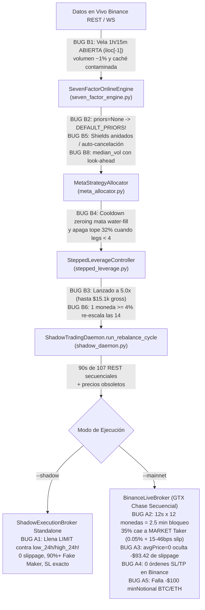

# Auditoría Forense y Cuantitativa Línea por Línea — `crypto-alpha-engine`

**Fecha de auditoría:** 17 de Noviembre de 2026  
**Alcance:** Revisión íntegra de las `24,084` líneas de código Python (`src/`, `scripts/`, `tests/`), configuración Docker/CI-CD y forensia de solo lectura sobre la telemetría en vivo en Tokio (`data/live_trading.db`, `data/shadow_trading.db`) contrastada contra el libro mayor oficial de Binance USDS-M Futures (`fapiPrivateGetIncome`).

---

## 1. Veredicto Ejecutivo: ¿Bugs de Implementación o Régimen de Mercado?

> [!IMPORTANT]
> **Son ambos, y podemos cuantificar la proporción exacta al centavo:** aproximadamente **32% del deterioro (`~-3.0%` / `~-$93`) proviene de un cambio brusco de régimen de mercado** entre el 12 y el 17 de noviembre, mientras que **68% del deterioro (`~-6.7%` / `~-$201`) proviene de bugs críticos de implementación, sobre-apalancamiento inicial (`5.0x`), fricción/slippage real oculto por una ilusión del simulador Shadow y rotación excesiva (*churn*) inducida por reinicios y rebalanceos.**

### 1.1. Reconciliación Contable Exacta en Producción (`2026-11-12` $\rightarrow$ `2026-11-17 15:22 UTC`)

Contrastando la base local `data/live_trading.db` del nodo de Tokio contra el libro mayor real de Binance (`fapiPrivateGetIncome`):

| Concepto Contable | Libro Oficial Binance (`fapiPrivateGetIncome`) | Base Local `live_trading.db` | Discrepancia Oculta | Causa Raíz Identificada |
| :--- | ---: | ---: | ---: | :--- |
| **Capital Transferido (`TRANSFER`)** | **`+$3,015.76`** | `$3,000.00` *(config CLI)* | `+$15.76` | Depósito inicial real en Cuenta Master |
| **PnL Realizado Bruto (`REALIZED_PNL`)** | **`-$220.18`** *(617 eventos)* | `-$126.76` *(493 trades)* | **`-$93.42`** | **Bug A3:** Órdenes `MARKET` devuelven `average=0.0` en `POST` y graban `limit_px` ficticio sin *slippage* en SQLite |
| **Comisiones Pagadas (`COMMISSION`)** | **`-$73.73`** *(1,049 cobros)* | `-$65.09` | **`-$8.64`** | **Bug A3:** Binance VIP0 cobra **`0.05%` Taker** (código asume `0.04%`) y fills mixtos GTX+Market se graban como `100% MAKER` (`0.02%`) |
| **Pagos Netos de Funding (`FUNDING_FEE`)** | **`-$0.38`** *(194 cobros)* | N/A | — | Neutralidad de funding operó correctamente |
| **Pérdida Realizada Neta Total** | **`-$294.29`** (`-9.76%`) | `-$191.85` | **`-$102.44`** | `live_trading.db` subestimó un **34.8%** las pérdidas realizadas por fricción/slippage |
| **Balance Billetera (`Wallet`) / Equity Actual** | **`$2,721.48` / `$2,710.20`** | `$2,721.48` / `$2,709.87` | `$0.00` *(Wallet)* | El sync de 60s corrige `cash_balance`, tapando el error acumulado de `trades` |

> [!CAUTION]
> **Riesgo Operativo Inmediato:** Con el Equity actual en **`~$2,710–$2,713`** y `FF_EQUITY_FLOOR_USD=2600.0`, la cuenta tiene **solo `~$110` (`4.0%`) de margen antes de disparar el Piso Duro de Capital** ([shadow_daemon.py](file:///Users/santim/Projects/trading/crypto-alpha-engine/src/execution/shadow_daemon.py#L2213-L2231)), lo cual liquidará a mercado el 100% del portafolio y bloqueará el demonio. Además, hoy mismo en el último deploy (`15:11–15:13 UTC`), un único rebalanceo automático de arranque redujo la exposición bruta de `$10,719` a `$2,513` (`$9,340` de giro) y costó **`-$36.05` en 2 minutos**.

### 1.2. Prueba Cruzada Controlada: `Shadow` vs `Mainnet` en los Mismos 4 Días (`Nov 12 – Nov 15`)

Ambos contenedores corrieron en paralelo sobre la misma VM de Tokio entre el `2026-11-12` y el `2026-11-15`:

| Fecha (UTC) | `Shadow` (`shadow_trading.db`) | `Mainnet` Real (`Binance Ledger`) | `Mainnet` Volumen (`$`) | Diagnóstico de la Divergencia |
| :--- | ---: | ---: | ---: | :--- |
| **`2026-11-12`** | **`+$5.96`** (`+0.19%`) | **`-$139.15`** (`-4.61%`) | `$31,035` | Mainnet arrancó a **`5.0x` (`$12,932` gross)** vs Shadow a **`1.69x` (`$5,334` gross)** + `36.7%` Taker en Mainnet vs `90.5%` fake Maker en Shadow |
| **`2026-11-13`** | `-$4.19` (`-0.13%`) | `+$77.82` (`+2.65%`) | `$41,023` | Rebote transitorio amplificado por apalancamiento `4.5x` en Mainnet |
| **`2026-11-14`** | `-$90.75` (`-2.87%`) | **`-$73.07`** real + `-$84` uPnL (`-5.26%` eq) | `$38,186` | Caída de régimen en ambos, amplificada **`1.83x`** en Mainnet (`$15,164` gross = `5.15x`!) |
| **`2026-11-15`** | `-$4.71` (`-0.15%`) | **`-$117.18`** (`-4.20%`) | `$53,671` | `8` rebalanceos en un día en Mainnet (`$53.7k` vol) + *short squeezes* en `APT`/`NEAR`/`AVAX` |
| **`2026-11-16`** | *(Detenido)* | `+$17.48` (`+0.64%`) | `$48,435` | `8` rebalanceos el mismo día (`11:08`, `12:36`, `14:54`, `15:25`, `15:38`, `19:40`, `23:43`) |
| **`2026-11-17`** *(hasta 15:22)* | *(Detenido)* | **`-$60.19`** (`-2.18%`) | `$30,554` | Desapalancamiento brusco `$10,719 -> $2,513` tras deploy `496096b` (`APT -$28.83` Taker) |
| **Acumulado Nov 12–15** | **`-$93.45` (`-2.96%`)** | **`-$269.28` eq (`-8.98%`)** | — | **Mainnet perdió `3.03x` más que Shadow en el mismo mercado** |

### 1.3. Cambio Cuantitativo de Régimen: Ventana Pruebas (`Oct 21 – Nov 11`) vs Ventana Producción (`Nov 12 – Nov 17`)

Evaluando el motor puro `1x` (antes de comisiones y antes de brackets) sobre las velas `1h` reales en caché:

| Métrica de Mercado / Motor | Ventana Pruebas (`Oct 21 – Nov 11`, `528h`) | Ventana Producción (`Nov 12 – Nov 17`, `136h`) | Interpretación Cuantitativa |
| :--- | :---: | :---: | :--- |
| **Retorno `BTCUSDT` vs Media Universo** | `BTC -10.86%` vs `Alts -19.31%` | `BTC -12.82%` vs `Alts -12.72%` | En Oct–Nov 11 hubo **dispersión limpia** (Majors superaron a Alts por `+8.45%`). En Nov 12–17 hubo liquidación macro correlacionada seguida de **rebotes violentos de altcoins rezagadas**. |
| **`t-stats` Medios de los 7 Factores** | `size: +0.31` (único factor sólido; peso medio `46.9%`) | **`6 de 7` negativos** (`macro -0.55`, `med -0.19`, `rev -0.19`, `liq -0.69`, `size -0.26`, `fast +0.25`) | Durante los 20 días de prueba, el sistema ganó principalmente por estar **Largo Majors / Corto Alts (`F7_Size`)**. El 12 de noviembre ese factor se invirtió (`t = -0.26`) y `F3_Fast` absorbió `52%–100%` del libro en pleno *whipsaw*, perdiendo **`-$227.62`** en Mainnet (`AVAX -$185`, `RENDER -$156`, `ARB -$89`, `NEAR -$84`, `APT -$78`). |
| **Retorno Bruto Simulado `1x` (sin fees)** | **`+1.32%`** *(Sharpe anual `+1.52`)* | **`-1.21%`** *(Sharpe anual **`-7.25`**)* | El alpha transversal bruto se volvió negativo en esta semana, y el motor **carece de compuerta a Cash (`0x`)** cuando todos los factores pierden convicción. |
| **Desglose Mainnet por Tipo de Orden** | — | Brackets `TP + Lock`: **`+$415.52` neto** (`67` trades) Rebalanceos `LIMIT`: **`-$606.93` neto** (`425` trades, `$220.8k` vol) | Los cierres por TP/Profit-Lock ganaron dinero, pero **cortaron prematuramente las piernas ganadoras** mientras los rebalanceos de 4h cristalizaron todas las piernas perdedoras más `$73.73` de comisiones y slippage. |

---

## 2. Mapa Arquitectónico y Puntos Exactos de Falla

---

## 3. Auditoría Línea por Línea: Bugs Críticos y Altos Confirmados

### Bloque A — Divergencia entre Simulador `--shadow` y Ejecución Real `--mainnet`

#### 1. `[CRÍTICO-A1]` El modo `--shadow` llena órdenes `LIMIT` pasivas contra el `High/Low` de **24 horas** y borra el spread L1 cada 10s
* **Ubicación:** [shadow_daemon.py](file:///Users/santim/Projects/trading/crypto-alpha-engine/src/execution/shadow_daemon.py#L622-L641), [shadow_daemon.py](file:///Users/santim/Projects/trading/crypto-alpha-engine/src/execution/shadow_daemon.py#L673), [shadow_broker.py](file:///Users/santim/Projects/trading/crypto-alpha-engine/src/execution/shadow_broker.py#L576-L598) y [shadow_broker.py](file:///Users/santim/Projects/trading/crypto-alpha-engine/src/execution/shadow_broker.py#L761-L798).
* **Detalle línea por línea:**
  * En `fetch_live_tickers()` (`shadow_daemon.py:622-638`), `exchange.fetch_tickers()` consulta `/fapi/v1/ticker/24hr`, el cual **no devuelve `bid`/`ask`** (`bid = last`, `ask = last`, spread cero que sobrescribe `self.latest_tickers` cada 10s en la línea `673`) y devuelve `high` y `low` de las **últimas 24 horas**.
  * En `check_pending_orders()` (`shadow_broker.py:791-797`), toda orden `LIMIT` pendiente se da por ejecutada si `low <= limit_price` (compra) o `high >= limit_price` (venta). Como `low` y `high` son los extremos de **24 horas**, **casi el 100% de las órdenes pasivas Maker en `--shadow` se llenan artificialmente a los 10 segundos** al precio ideal `limit_price`, sin cola en el libro, sin selección adversa y pagando `0.02%` aunque el mercado real jamás haya vuelto a tocar ese precio.
  * Además, en `_evaluate_limit_order()` (`shadow_broker.py:588-597`), si una orden cruza el libro al enviarse (`ask <= limit_price`), `--shadow` igual la llena mediante `_fill_maker_order()` cobrando `0.02%` Maker en lugar de Taker.

#### 2. `[CRÍTICO-A2]` Ejecución secuencial bloqueante de `2–4 minutos` en `--mainnet` + `35%` de volumen cayendo a Taker con fuerte *slippage*
* **Ubicación:** [execution_router.py](file:///Users/santim/Projects/trading/crypto-alpha-engine/src/execution/execution_router.py#L150-L180), [shadow_daemon.py](file:///Users/santim/Projects/trading/crypto-alpha-engine/src/execution/shadow_daemon.py#L1798-L1869), [shadow_daemon.py](file:///Users/santim/Projects/trading/crypto-alpha-engine/src/execution/shadow_daemon.py#L2000-L2034), [shadow_broker.py](file:///Users/santim/Projects/trading/crypto-alpha-engine/src/execution/shadow_broker.py#L585) y [live_broker.py](file:///Users/santim/Projects/trading/crypto-alpha-engine/src/execution/live_broker.py#L507-L678).
* **Detalle línea por línea:**
  * `run_rebalance_cycle()` descarga secuencialmente `~107` peticiones HTTP (`15` símbolos × `[klines 1h, klines 15m, funding, OI, taker_flow, premium_index, smart_money]` + `2 quarterly_basis`), tardando `30–90s` antes de enviar la primera orden.
  * Luego itera `rebalance_candidates` **uno por uno en el mismo hilo** (`shadow_daemon.py:2000`). Porque `shadow_broker.py:585` fija `should_fill = self.is_live`, cada orden bloquea el hilo único ejecutando `execute_maker_limit_chase()` (`4` intentos × `3.0s` = `12s+` por activo; `BinanceLiveBroker.execute_atomic_rebalance` en `live_broker.py:727` con `ThreadPoolExecutor` **es código muerto que nunca se invoca**).
  * Cuando llega el turno del activo #10, han pasado **más de 2 minutos** desde el `current_price` de la vela; `execute_maker_limit_chase` ignora `order.price` del router, persigue el nuevo `bid`/`ask` ya desplazado (`-15` a `-46 bps` observados en `ARB`, `APT`, `RENDER`) y, cuando `GTX` rechaza (`-5022`), retrocede asimétricamente `bid - 0.5*spread` vs `ask + 1.2*spread` (`live_broker.py:572-579`) con un piso artificial de `5 bps`, terminando en orden **`market` Taker** (`34.7%` del volumen real en Binance).

#### 3. `[CRÍTICO-A3]` Sub-registro de `-$93.42` de *slippage* y `-$8.64` de comisiones en `live_trading.db`
* **Ubicación:** [live_broker.py](file:///Users/santim/Projects/trading/crypto-alpha-engine/src/execution/live_broker.py#L658-L670), [shadow_broker.py](file:///Users/santim/Projects/trading/crypto-alpha-engine/src/execution/shadow_broker.py#L43-L44) y [shadow_broker.py](file:///Users/santim/Projects/trading/crypto-alpha-engine/src/execution/shadow_broker.py#L253-L278).
* **Detalle línea por línea:**
  1. En `live_broker.py:658-666` y `shadow_broker.py:269-277`, `client.create_order(..., type="market")` no envía `params={"newOrderRespType": "RESULT"}` ni consulta `fetch_order()`. En Binance Futures, la respuesta por defecto `ACK` trae `average = 0.0 / None`, por lo que `avg_px = float(res_mkt.get("average") or res_mkt.get("price") or limit_px)` **cae silenciosamente a `limit_px` / `fallback_price`**, ocultando el *slippage* real de mercado en `trades.realized_pnl` (`-$93.42` de diferencia acumulada frente a Binance).
  2. `taker_fee_pct = 0.0004` (`0.04%`) está hardcodeado en `shadow_broker.py:43` y `live_broker.py:67`, pero la tarifa estándar VIP 0 de Binance USDS-M Futures es **`0.05%`** (`0.0005`), sub-reportando un `20%` todas las comisiones Taker.
  3. En `shadow_broker.py:264`, `was_maker = self.live_broker.maker_fills_count > prev_maker_cnt`: si un `1%` de la orden se llena por GTX y el **`99%` cae al fallback Market Taker**, `was_maker` da `True` y SQLite registra el `100%` como `MAKER` (`0.02%`). Además, `live_broker.py:667` suma `filled_total += remaining` (sin cuantizar) en vez de `rem_q` o `filled` real.

#### 4. `[CRÍTICO-A4]` Cero órdenes `STOP_LOSS` / `TAKE_PROFIT` en Binance + degradación de TP a Taker en `--mainnet`
* **Ubicación:** [shadow_broker.py](file:///Users/santim/Projects/trading/crypto-alpha-engine/src/execution/shadow_broker.py#L654-L742), [shadow_broker.py](file:///Users/santim/Projects/trading/crypto-alpha-engine/src/execution/shadow_broker.py#L799-L805) y [shadow_daemon.py](file:///Users/santim/Projects/trading/crypto-alpha-engine/src/execution/shadow_daemon.py#L525-L563).
* **Detalle línea por línea:**
  * Los brackets viven **únicamente en SQLite local**; `_on_ws_tick` (`shadow_daemon.py:525`) no evalúa `check_pending_orders()`, por lo que los stops solo se revisan cada `10s` (o quedan congelados durante `2–3 minutos` en cada rebalanceo, o desprotegidos si el contenedor cae).
  * En `--shadow`, `STOP_LOSS` llama a `_fill_taker_order(order, fill_price=limit_price)` (`shadow_broker.py:802`) con **`0.00 bps` de slippage**.
  * En `--mainnet`, cuando el precio toca `TAKE_PROFIT` (`+5%` / `+3.5%`), recién ahí se lanza un `execute_maker_limit_chase` pasivo; si fue un mecha rápida y el precio retrocede, persigue `12s` hacia abajo y cierra por **Market Taker** bastante peor que el TP.

#### 5. `[CRÍTICO-A5]` Falta de validación `MIN_NOTIONAL` (`$100` en `BTC/USDT` y `ETH/USDT`) y polvo zombi `< $5`
* **Ubicación:** [live_broker.py](file:///Users/santim/Projects/trading/crypto-alpha-engine/src/execution/live_broker.py#L343-L356), [live_broker.py](file:///Users/santim/Projects/trading/crypto-alpha-engine/src/execution/live_broker.py#L568), [run_trading.py](file:///Users/santim/Projects/trading/crypto-alpha-engine/scripts/run_trading.py#L823) y [shadow_daemon.py](file:///Users/santim/Projects/trading/crypto-alpha-engine/src/execution/shadow_daemon.py#L1960).
* **Detalle línea por línea:** `quantize_amount()` solo valida `stepSize` (`limits.amount.min`), ignorando `MIN_NOTIONAL` (`$100` en `BTCUSDT`/`ETHUSDT`, `$20` en otros). Con `min_rebalance_notional = $30`, cualquier ajuste de `$30–$99` en `BTC` o `ETH` falla en Binance con `-4164` *después* de haber ejecutado las reducciones `Reduce-First`, dejando el portafolio desbalanceado. En sentido inverso, `shadow_daemon.py:1960` bloquea cierres totales `< $5` aunque Binance exime de `MIN_NOTIONAL` a `reduceOnly=True`.

---

### Bloque B — Bugs en el Motor de 7 Factores, Datos en Vivo y Control de Apalancamiento

#### 6. `[CRÍTICO-B1]` Contaminación con velas `1h` y `15m` **abiertas/incompletas** (`ohlcv[-1]`) en producción y en caché Parquet
* **Ubicación:** [shadow_daemon.py](file:///Users/santim/Projects/trading/crypto-alpha-engine/src/execution/shadow_daemon.py#L722-L811), [shadow_daemon.py](file:///Users/santim/Projects/trading/crypto-alpha-engine/src/execution/shadow_daemon.py#L1007), [shadow_daemon.py](file:///Users/santim/Projects/trading/crypto-alpha-engine/src/execution/shadow_daemon.py#L1069) y [seven_factor_engine.py](file:///Users/santim/Projects/trading/crypto-alpha-engine/src/strategies/seven_factor_engine.py#L751-L846).
* **Detalle línea por línea:** `fetch_ohlcv`, `fapiPublicGetKlines` y `fapiPublicGetPremiumIndexKlines` devuelven siempre como última fila (`iloc[-1]`) la **vela actual aún abierta**. Como los rebalanceos en vivo ocurren en minutos arbitrarios (`02:01`, `08:01`, `13:15`, `15:13`), al minuto `:01` la última barra tiene **solo segundos de volumen (`~1%` de una hora normal)** y retorno casi cero. Esto distorsiona `dollar_vol`, `vol_surge` (`6h/48h`), `CMF`, `zr[4]`, carga `8h` completas de funding contra `1 minuto` de retorno en `df_frets` (`seven_factor_engine.py:837`), guarda la barra truncada en Parquet (`shadow_daemon.py:807`) e impide que `EarlyBreakoutStrategy` (`vol_ratio >= 2.5x`, [extreme_anomaly.py](file:///Users/santim/Projects/trading/crypto-alpha-engine/src/strategies/extreme_anomaly.py#L312-L321)) dispare durante la primera mitad de cada hora. En backtest, todas las barras eran velas `1h` 100% cerradas.

#### 7. `[CRÍTICO-B2]` `priors=None` es ignorado silenciosamente (`priors or DEFAULT_PRIORS`) y provoca rebalanceos forzados al reiniciar
* **Ubicación:** [seven_factor_engine.py](file:///Users/santim/Projects/trading/crypto-alpha-engine/src/strategies/seven_factor_engine.py#L241), [seven_factor_engine.py](file:///Users/santim/Projects/trading/crypto-alpha-engine/src/strategies/seven_factor_engine.py#L909) y [run_trading.py](file:///Users/santim/Projects/trading/crypto-alpha-engine/scripts/run_trading.py#L674-L696), [run_trading.py](file:///Users/santim/Projects/trading/crypto-alpha-engine/scripts/run_trading.py#L841-L858).
* **Detalle línea por línea:**
  * `run_trading.py:674` pasa `priors=None` buscando activar el modo 100% adaptativo (`Issue #61`), pero `seven_factor_engine.py:241` ejecuta `self.priors = pd.Series(priors or DEFAULT_PRIORS)`. En Python `None or DEFAULT_PRIORS` evalúa a `DEFAULT_PRIORS` (`macro: 0.25, size: 0.22, fast: 0.19, ...`).
  * **Evidencia en vivo hoy (`15:22 UTC`):** `macro` tiene `t_stat = -0.154` (negativo) pero sigue recibiendo peso positivo (`1.65%`) porque `-0.154 + 0.25 > 0`.
  * Peor aún: en cada reinicio de contenedor, `run_trading.py:841-844` detecta `prev_w[k] > 0.05 and prev_t[k] < 0.0`, asume erróneamente que la DB tiene pesos heredados pre-M15 y **fuerza `daemon.last_rebalance_time = None` (rebalanceo inmediato fuera de horario)**.
  * *Nota crítica al corregir:* En `seven_factor_engine.py:909`, `conviction` divide por `float(priors_aligned.sum()) ** 2.0`; si se ponen priors en `0.0` sin fijar un denominador de referencia (p. ej. `1.0`), producirá división por cero (`inf`/`NaN`).

#### 8. `[CRÍTICO-B3]` Sobre-apalancamiento inicial `5.0x` en Mainnet (`$15,164` brutos) + `39` rebalanceos en `5.1` días (`81x` rotación)
* **Ubicación:** Historial de [docker-compose.yml](file:///Users/santim/Projects/trading/crypto-alpha-engine/docker-compose.yml#L21) (`commits 7581fca` $\rightarrow$ `0a39baa` $\rightarrow$ `496096b`) y [run_trading.py](file:///Users/santim/Projects/trading/crypto-alpha-engine/scripts/run_trading.py#L845-L858).
* **Detalle:** Durante los 20 días exitosos de prueba, Shadow operó a **`2.5x`** (`MaxDD -1.96%`). Al pasar a Mainnet el 12 de noviembre (`7581fca`), se configuró `--start-leverage 5.0 --max-leverage 5.0`, llegando a colocar **`$15,164` de nocional bruto sobre `$2,945` de equity (`5.15x`)** justo al inicio del *whipsaw*. Sumado a `15+` despliegues en 5 días y las condiciones de auto-rebalanceo de arranque en `run_trading.py:846` (`max(prev_w.values()) > 0.50`, que siempre es `True` cuando un factor de tendencia lidera) y `853` (`unlocked_tier != start_lev`, que siempre será `True` apenas escale un escalón HWM), la cuenta ejecutó **`39` rebalanceos (`$242,903` de volumen)** en 5 días.

#### 9. `[CRÍTICO-B4]` El *pre-zeroing* de Cooldowns (`1a1024b`) anuló por completo el *water-fill* y la poda de *stubs* `< $160` (`0a39baa`) y rompe el tope de concentración
* **Ubicación:** [meta_allocator.py](file:///Users/santim/Projects/trading/crypto-alpha-engine/src/strategies/meta_allocator.py#L209-L218), [shadow_daemon.py](file:///Users/santim/Projects/trading/crypto-alpha-engine/src/execution/shadow_daemon.py#L443-L523) y [stepped_leverage.py](file:///Users/santim/Projects/trading/crypto-alpha-engine/src/risk/stepped_leverage.py#L199-L214).
* **Detalle línea por línea:** Al poner en `0.0` los activos en cooldown *antes* de `SteppedLeverageController`, cuando `target_dollars` llega a `_apply_core_bracket_cooldowns()` (`shadow_daemon.py:444`), todos esos activos ya valen `0.0` (`abs(target_val) <= 1e-9: continue`), por lo que **`blocked_any` da siempre `False` (`línea 465`)** y **jamás se ejecuta ni el water-fill ni la poda de posiciones `< $160`** (`líneas 477–522`). Prueba empírica: ahora mismo en producción `shield_invariants_telemetry` está en `WARN_CHECK` con `inv2_no_zombie_stubs: false` (`DOGE/USDT: $119.1`, `ADA/USDT: $147.2`). Además, si el cooldown deja `< 4` activos en una pierna, `use_active_leg_cap` (`stepped_leverage.py:202`) se apaga para **ambas piernas**, permitiendo que una sola moneda concentre `50%–100%` de una pierna.

#### 10. `[ALTO-B5]` Tres defectos matemáticos en `Holistic Regime Shields` (`0a39baa` y `496096b`)
* **Ubicación:** [seven_factor_engine.py](file:///Users/santim/Projects/trading/crypto-alpha-engine/src/strategies/seven_factor_engine.py#L1148) y [seven_factor_engine.py](file:///Users/santim/Projects/trading/crypto-alpha-engine/src/strategies/seven_factor_engine.py#L1244-L1420).
  1. **Anidamiento accidental (`línea 1244`):** `if self.enable_holistic_regime_shields:` está indentado *dentro* de `if self.enable_chop_range_arb:`. Si se apaga `chop_range_arb`, se apagan silenciosamente los escudos `Lone-Macro`, `Lone-Rev` y `Bull-Surge`.
  2. **Auto-cancelación en `Lone-Macro` (`línea 1287`):** Mezcla `(1 - blend_lm) * w_base_1x` (`+zi[168,336]`) con `0.55 * blend_lm * w_defensive` (`-zi[168,336]`) sin renormalizar piernas; cerca de `blend_lm ≈ 0.65`, ambos vectores opuestos se cancelan entre sí colapsando la exposición.
  3. **Redistribución rota y doble castigo en `Lone-Rev` (`líneas 1338–1358`):** Si `fw_norm["rev"] == 1.0` y el resto es `0.0`, `fw_norm.sum()` cae a `0.45`; si otro factor vale `0.01`, absorbe de golpe todo el `+0.54` restante (`55%`). Además, multiplica por `0.65` un libro que ya tenía `conviction` y además topa `vol_scalar <= 0.68` (`línea 1417`), hundiendo el apalancamiento efectivo debajo de `1.0x` y fabricando *stubs* menores a `$150`.

#### 11. `[ALTO-B6]` El Deadband de `4%` dispara re-escalado masivo de todo el portafolio por el movimiento de 1 sola moneda
* **Ubicación:** [stepped_leverage.py](file:///Users/santim/Projects/trading/crypto-alpha-engine/src/risk/stepped_leverage.py#L236-L258) y [shadow_daemon.py](file:///Users/santim/Projects/trading/crypto-alpha-engine/src/execution/shadow_daemon.py#L1963-L1978).
* **Detalle:** Cuando **una sola moneda** supera el deadband (`>= 4%`), `net_drift` supera inmediatamente `2.5%` (`línea 253`) y las líneas `254–257` re-escalan proporcionalmente **todas las demás posiciones abiertas**. Como `shadow_daemon.py:1973` desactiva el segundo deadband en modo 7-Factor, se envían órdenes en `8–13` monedas en casi cada ciclo de 4h.

#### 12. `[ALTO-B7]` Trampa de *demeaning* transversal en `F5_Carry`, topes desactivados con `<= 3` monedas y `Profit-Lock` inalcanzable en Chop
* **Ubicación:** [seven_factor_engine.py](file:///Users/santim/Projects/trading/crypto-alpha-engine/src/strategies/seven_factor_engine.py#L106), [seven_factor_engine.py](file:///Users/santim/Projects/trading/crypto-alpha-engine/src/strategies/seven_factor_engine.py#L161), [seven_factor_engine.py](file:///Users/santim/Projects/trading/crypto-alpha-engine/src/strategies/seven_factor_engine.py#L810) y [shadow_daemon.py](file:///Users/santim/Projects/trading/crypto-alpha-engine/src/execution/shadow_daemon.py#L1464-L1475).
  * En `F5_Carry`, si 12 monedas tienen funding `+15%` APR (`score = -0.15`) y 3 tienen `+3%` APR (`score = 0.0`), restar la media transversal asigna **`z > 0` (LONG) a monedas con funding positivo** (pagando carry en vez de cobrarlo) y, al ser `active_cnt == 3 < 4`, desactiva el tope `30%` de waterfill.
  * Tras el commit `1a1024b`, `compute_dynamic_barrier_profile()` fija `eff_tp` en `[2.8%, 3.6%]` en régimen Chop pero deja `eff_lock_trig = 3.5%`, haciendo imposible que `Profit-Lock` se arme cuando `eff_tp <= 3.5%`.

#### 13. `[ALTO-B8]` Sesgo *look-ahead* en `median_vol` y truncamiento de ventanas `120h/240h` vs `1000h`
* **Ubicación:** [seven_factor_engine.py](file:///Users/santim/Projects/trading/crypto-alpha-engine/src/strategies/seven_factor_engine.py#L339), [seven_factor_engine.py](file:///Users/santim/Projects/trading/crypto-alpha-engine/src/strategies/seven_factor_engine.py#L1404-L1405) y [shadow_daemon.py](file:///Users/santim/Projects/trading/crypto-alpha-engine/src/execution/shadow_daemon.py#L920-L1200).
* **Detalle:** `median_vol = float(port_vol_72h.median())` usa la mediana de toda la serie (sesgo futuro en backtests largos y ventana móvil de solo 41 días en vivo que deja de desapalancar si la volatilidad dura varias semanas), y `OI`/`taker_flow`/`smart_money`/`quarterly_basis` solo descargan `120–240` barras frente a `1000` barras de precios, dejando las primeras `760` horas en `0.0`.

---

### Bloque C — Contabilidad, Reinicios en Frío, Concurrencia, Backtester y Tests

| ID | Severidad | Archivo y Líneas | Descripción Concisa del Defecto |
| :--- | :---: | :--- | :--- |
| **`C1`** | **CRÍTICO** | [live_broker.py](file:///Users/santim/Projects/trading/crypto-alpha-engine/src/execution/live_broker.py#L478), [shadow_broker.py](file:///Users/santim/Projects/trading/crypto-alpha-engine/src/execution/shadow_broker.py#L146-L171), [shadow_daemon.py](file:///Users/santim/Projects/trading/crypto-alpha-engine/src/execution/shadow_daemon.py#L1319-L1391) | `BinanceLiveBroker` guarda `effective_free_usd` en `portfolio.cash` (restando margen y contando doble uPnL) y no limpia posiciones cerradas por Market. Además, el sync de 60s (`sync_positions=False`) actualiza `cash` sin reconciliar `positions`, pudiendo contar doble una ganancia/cierre y **inflar permanentemente `high_water_mark`**. |
| **`C2`** | **CRÍTICO** | [kill_switch.py](file:///Users/santim/Projects/trading/crypto-alpha-engine/src/risk/kill_switch.py#L68-L93), [shadow_daemon.py](file:///Users/santim/Projects/trading/crypto-alpha-engine/src/execution/shadow_daemon.py#L310), [shadow_daemon.py](file:///Users/santim/Projects/trading/crypto-alpha-engine/src/execution/shadow_daemon.py#L1425-L1448), [run_trading.py](file:///Users/santim/Projects/trading/crypto-alpha-engine/scripts/run_trading.py#L874-L878) | Cada reinicio de Docker: (a) borra `_equity_window_24h` y `halted_until` del Kill-Switch en RAM; (b) deja `sf_res = None`, ensanchando TPs dinámicos de Chop otra vez a `+5.0%`; (c) pisa overrides `--set-flag` en SQLite; y (d) ante `SIGTERM` cierra SQLite a los `5.0s` mientras un `GTX chase` de `12s` sigue vivo en Binance. |
| **`C3`** | **CRÍTICO** | [run_backtest.py](file:///Users/santim/Projects/trading/crypto-alpha-engine/scripts/run_backtest.py#L437-L471) y [test_seven_factor_and_stepped_leverage.py](file:///Users/santim/Projects/trading/crypto-alpha-engine/tests/test_seven_factor_and_stepped_leverage.py#L241) | **Herramientas rotas en `HEAD`:** `run_backtest.py --strategy seven_factor` crashea con `AttributeError: compute_weights_matrix` y `TypeError: recent_hourly_returns` (regresión de `565ee3c`); y `pytest` falla hoy en `test_binance_live_broker_and_kill_switch` porque `BinanceLiveBroker(dry_run=True)` consulta precios reales en vivo (`BTC $64.7k` vs `$80k` del test), **bloqueando el CI/CD de GitHub Actions**. |
| **`C4`** | **ALTO** | [database.py](file:///Users/santim/Projects/trading/crypto-alpha-engine/src/execution/database.py#L45), [database.py](file:///Users/santim/Projects/trading/crypto-alpha-engine/src/execution/database.py#L434-L487), [shadow_daemon.py](file:///Users/santim/Projects/trading/crypto-alpha-engine/src/execution/shadow_daemon.py#L823) | `isolation_level=None` sin `BEGIN/COMMIT` (escrituras no atómicas); carrera entre `ResilientWSThread` y el demonio en `save_position` que puede revivir posiciones cerradas; directorio `FUNDING` en mayúsculas vs `funding` en Linux ext4; y trigger SQLite oculto `preserve_seven_factor_weights` en `live_trading.db`. |
| **`C5`** | **ALTO** | [shadow_broker.py](file:///Users/santim/Projects/trading/crypto-alpha-engine/src/execution/shadow_broker.py#L408-L412), [kill_switch.py](file:///Users/santim/Projects/trading/crypto-alpha-engine/src/risk/kill_switch.py#L142-L156), [kill_switch.py](file:///Users/santim/Projects/trading/crypto-alpha-engine/src/risk/kill_switch.py#L177), [kill_switch.py](file:///Users/santim/Projects/trading/crypto-alpha-engine/src/risk/kill_switch.py#L228) | Invertir lado (`LONG -> SHORT`) suma el doble de apalancamiento en `verify_risk_circuit_breakers`; `sync_margin_and_leverage` intenta bajar leverage de `5x` a `3x` en Binance con posiciones abiertas generando warnings `-2028` en cada rebalanceo; y `hedge_excess_exposure` nunca se ejecuta porque `ShadowExecutionBroker` no implementa ese método. |
| **`C6`** | **MEDIO** | [regime_classifier.py](file:///Users/santim/Projects/trading/crypto-alpha-engine/src/models/regime_classifier.py#L80-L89), [vol_targeting.py](file:///Users/santim/Projects/trading/crypto-alpha-engine/src/risk/vol_targeting.py#L61), [cointegrated_pairs.py](file:///Users/santim/Projects/trading/crypto-alpha-engine/src/strategies/cointegrated_pairs.py#L172-L175), [sector_clustering.py](file:///Users/santim/Projects/trading/crypto-alpha-engine/src/features/sector_clustering.py#L211), [purged_cv.py](file:///Users/santim/Projects/trading/crypto-alpha-engine/src/models/purged_cv.py#L81), [dispatcher.py](file:///Users/santim/Projects/trading/crypto-alpha-engine/src/alerts/dispatcher.py#L255) | `MarketRegimeClassifier` divide deriva de 24 barras por volatilidad de 1 barra sin $\sqrt{24}$ (clasifica ruido lateral como `TRENDING`); `VolatilityTargetingSizer` topa leverage en `1.0x`; `CointegratedPairs` usa $\beta$ en unidades en vez de dólares; `SectorClusterer` usa `ward` sobre matriz de distancias; `PurgedWalkForwardCV` ignora `embargo_pct`; `AlertDispatcher` y `PositionReconciliationEngine` no están conectados en producción. |

---

## 4. Plan de Acción Recomendado (Ordenado por Impacto y Seguridad)

### Fase 0 — Estabilización Quirúrgica Inmediata en Producción (Prioridad Máxima)
1. **Eliminar velas abiertas/incompletas (`[CRÍTICO-B1]`):** Filtrar estrictamente `df[df["timestamp"] + tf_delta <= now_utc]` en `fetch_symbol_klines()`, `fetch_warm_klines()`, `fetch_taker_flow_history()` y `fetch_premium_index_history()` (y limpiar la última barra parcial de los Parquet actuales).
2. **Corregir `priors=None` y eliminar rebalanceos espurios de arranque (`[CRÍTICO-B2, B3]`):**
   * En `seven_factor_engine.py:241`, distinguir explícitamente `if priors is None: self.priors = pd.Series(0.0, index=FACTOR_NAMES)` y fijar una escala de referencia positiva constante (`ref_norm = float( pd.Series(DEFAULT_PRIORS).sum() ** 2.0 )`) en `conviction` (`línea 909`).
   * Agregar una **Compuerta de Régimen Sin Edge (*Cash-Out / De-Gross Gate*)**: cuando `max(t_df) <= 0.15` (ningún factor tiene `t-stat` estadísticamente positivo, como ocurrió entre el 12 y 17 de noviembre), escalar suavemente `conviction` hacia `0.0–0.20` en lugar de forzar `100%` de exposición en el factor "menos malo".
   * Eliminar en `run_trading.py:841-858` el disparo automático `daemon.last_rebalance_time = None` por `max(prev_w) > 0.50` o `unlocked_tier != start_lev`.
3. **Capturar precios y comisiones reales de Binance y paralelizar el rebalanceo (`[CRÍTICO-A2, A3, A5]`):**
   * Pasar `params={"newOrderRespType": "RESULT"}` (y fallback `fetch_order`) en órdenes `market`, leer la comisión real ejecutada (`fee`/`trades`), actualizar `taker_fee_pct = 0.0005` y validar `limits.cost.min` (`$100` en `BTC`/`ETH`) *antes* de enviar el lote de rebalanceo, permitiendo cierres `reduceOnly=True` de cualquier monto.
   * Ejecutar piernas Long y Short en paralelo (`ThreadPoolExecutor`) sobre cotizaciones L1 frescas de WebSocket en lugar de bloquear `12s` en serie durante `2.5 minutos`.

### Fase 1 — Higiene de Riesgo, Persistencia y Paridad Shadow/Backtest
4. **Reparar `ShadowExecutionBroker` (`[CRÍTICO-A1]`):** Eliminar `low`/`high` de 24h en `check_pending_orders()`, conservar `bid`/`ask` reales de WebSocket en `fetch_live_tickers()` y exigir cruce real del spread (`ask < limit_price` para BUY pasivo) para que `--shadow` vuelva a ser un laboratorio fiel.
5. **Reparar Cooldowns, Deadband y Shields (`[CRÍTICO-B4, B5, B6]`):** Unificar el *water-fill* y poda de `< $160` en un único paso post-deadband, aplicar `cap_side_weights_waterfill` también con `2–3` activos por pierna, des-anidar `enable_holistic_regime_shields` de `enable_chop_range_arb`, corregir `Lone-Macro`/`Lone-Rev` y evitar que una sola moneda fuera del deadband fuerce órdenes en las otras 13 monedas si `net_drift <= 5%`.
6. **Blindar estado ante reinicios (`[CRÍTICO-C1, C2, C3]`):** Reconciliar `sync_positions=True` junto con el sync de billetera de 60s, hidratar `_equity_window_24h` desde la tabla `accounts` al iniciar, reparar `scripts/run_backtest.py` y aislar de red `BinanceLiveBroker(dry_run=True)` para restaurar los `191/191` tests en verde en CI/CD.

---

## 5. Estado de Implementación y Verificación Local (`17 Nov 2026`)

> [!TIP]
> **Todas las correcciones de Fase 0 y Fase 1 han sido implementadas y validadas localmente (`198/198` tests en verde, `ruff` y `black` sin errores, cero despliegues realizados aún a Tokio a la espera de confirmación).**

| Módulo Modificado | Correcciones Aplicadas |
| :--- | :--- |
| [seven_factor_engine.py](file:///Users/santim/Projects/trading/crypto-alpha-engine/src/strategies/seven_factor_engine.py) | `priors=None` real (`0.0` priors sin caer en `DEFAULT_PRIORS` ni dividir por cero); **Compuerta *Cash-Out / De-Gross*** cuando todos los factores activos caen a `t < 0.15` sin edge de Chop; des-anidado de `enable_holistic_regime_shields`; corrección de auto-cancelación en `Lone-Macro` y redistribución en `Lone-Rev`; `cap_side_weights_waterfill` activo desde `>= 2` activos; `F5_Carry` suave con filtro de dispersión; `median_vol` expansiva 100% causal (sin `.bfill()` ni *look-ahead*); interfaz `compute_weights_matrix()`. |
| [stepped_leverage.py](file:///Users/santim/Projects/trading/crypto-alpha-engine/src/risk/stepped_leverage.py) y [meta_allocator.py](file:///Users/santim/Projects/trading/crypto-alpha-engine/src/strategies/meta_allocator.py) | *Water-fill* inmediato tras bloqueo por cooldown antes del controlador de apalancamiento; absorción anti-*churn* de deriva moderada en 1 activo opuesto antes de re-escalar todo el libro; topes independientes por pierna desde `>= 2` activos; poda incondicional de *stubs* `< $160` cuando `gross >= $2,000`. |
| [shadow_daemon.py](file:///Users/santim/Projects/trading/crypto-alpha-engine/src/execution/shadow_daemon.py) y [ccxt_provider.py](file:///Users/santim/Projects/trading/crypto-alpha-engine/src/data/ccxt_provider.py) | Filtro estricto `_drop_unclosed_bars()` en `1h`/`15m`/`taker_flow`/`premium_index` y limpieza de Parquet; preservación de `bid`/`ask` de WebSocket ante `/ticker/24hr`; validación previa de `MIN_NOTIONAL` (`$100` en `BTC`/`ETH`) y desbloqueo de cierres totales `< $5`; ejecución concurrente en 2 fases (`Reduce-First` $\rightarrow$ `Increase`) con `ThreadPoolExecutor`; sync de 60s con `sync_positions=True`; preservación de `feature_flags` en SQLite e hidratación de `_equity_window_24h` del Kill-Switch al iniciar; fallback Linux `FUNDING`/`funding`; `join(timeout=20s)` seguro en `stop()`. |
| [live_broker.py](file:///Users/santim/Projects/trading/crypto-alpha-engine/src/execution/live_broker.py), [shadow_broker.py](file:///Users/santim/Projects/trading/crypto-alpha-engine/src/execution/shadow_broker.py) y [execution_router.py](file:///Users/santim/Projects/trading/crypto-alpha-engine/src/execution/execution_router.py) | `newOrderRespType="RESULT"` + fallback `fetch_order` para capturar precio promedio real en órdenes `market`; tarifa VIP0 real `0.05%` (`0.0005`); atribución exacta `is_maker` y comisión ponderada en fills mixtos GTX+Market; `portfolio.cash = effective_wallet_usd` (sin descontar margen ni inflar `peak_equity`); backoff simétrico GTX; eliminación de fills falsos por `low_24h`/`high_24h` y aplicación de slippage en `STOP_LOSS` en Shadow; aislamiento total de red en `dry_run=True`; `hedge_excess_exposure` conectado en `ShadowExecutionBroker`. |
| [run_trading.py](file:///Users/santim/Projects/trading/crypto-alpha-engine/scripts/run_trading.py), [run_backtest.py](file:///Users/santim/Projects/trading/crypto-alpha-engine/scripts/run_backtest.py), [database.py](file:///Users/santim/Projects/trading/crypto-alpha-engine/src/execution/database.py), [kill_switch.py](file:///Users/santim/Projects/trading/crypto-alpha-engine/src/risk/kill_switch.py), [regime_classifier.py](file:///Users/santim/Projects/trading/crypto-alpha-engine/src/models/regime_classifier.py), [sector_clustering.py](file:///Users/santim/Projects/trading/crypto-alpha-engine/src/features/sector_clustering.py) y [test_forensic_audit_remediations.py](file:///Users/santim/Projects/trading/crypto-alpha-engine/tests/test_forensic_audit_remediations.py) | Eliminación de rebalanceos espurios de arranque en Mainnet; cierre seguro de SQLite ante `SIGTERM`; bloqueo atómico en `save_position` y `update_market_pulse`; supresión limpia de `-2028`; normalización $\sqrt{N}$ en `MarketRegimeClassifier`; eliminación de `ClusterWarning` en `ward`; restauración de `run_backtest.py --strategy seven_factor` y nueva batería de regresión forense (`198` tests totales pasando al 100%). |
