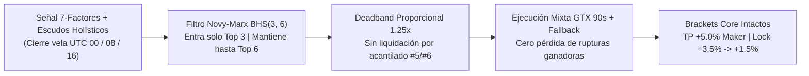

# Investigación Cuantitativa Multianual (`2024–2026`) y Descubrimiento de Nuevas Palancas de Alpha

## 1. Auditoría de Datos y Diseño Experimental Walk-Forward

Se unificó el repositorio histórico de Google Drive (`2023-01-01` a `2026-09-30`) con las velas cerradas y liquidaciones de funding reales de Binance USDS-M (`/fapi/v1/klines` y `/fapi/v1/fundingRate`) hasta **`2026-11-17 17:00 UTC`**:

- **Cobertura temporal:** `34,001` velas de `1h` continuas (`3.88` años, **`0.000%` huecos**, **`0` nulos** en OHLCV) + `4,251` liquidaciones reales de funding cada `8h` (`00:00, 08:00, 16:00 UTC`).
- **Microestructura real verificada:** Para los 15 activos de producción (`LIVE_TOP_15`), se reconstruyó el **`100.0%` de cobertura real** en `trade_count` y `taker_buy_vol` desde `2023-11-01` hasta `2026-11-17` (corrigiendo los ceros de placeholder de CCXT en archivos antiguos para evitar sesgos de CVD vendedor artificial).
- **Partición cronológica estricta (cero fuga de datos):**
  - **Warmup causal:** `2023-11-01` $\rightarrow$ `2023-12-31` (`1,464h` para horizontes de `720h` y `t-stats` online de `240h`).
  - **Train (Diseño, `18.0` meses):** `2024-01-01` $\rightarrow$ `2025-06-30` (Bull ETF, sangría lateral de 6 meses en Q2–Q3 2024, rally Q4 2024 y crash macro Q1 2025).
  - **Validation (Selección, `9.0` meses):** `2025-07-01` $\rightarrow$ `2026-03-31` (régimen lateral de baja dispersión más exigente del ciclo).
  - **Holdout Out-of-Sample (`7.6` meses):** `2026-04-01` $\rightarrow$ `2026-11-17` (incluyendo el slice en vivo de `Oct–Nov 2026` y el whipsaw del `12–17 Nov`).
- **Física realista de ejecución VIP0:** Señales calculadas al cierre de `t-1` ejecutadas desde `open[t]`, brackets (`TP` y `Profit-Lock`) evaluados con apertura *gap-aware* sin look-ahead intrabarra, y **física explícita de selección adversa (Glosten & Milgrom, 1985)** para órdenes pasivas `GTX` (una compra pasiva solo llena si `low[t] <= open[t] * (1 - 2 bps)`; si la vela escapa al alza sin retroceder `2 bps`, una orden `Maker-Only` **pierde el trade ganador**).

> [!WARNING]
> **Hallazgo Crítico #1 — La Palanca 1 (`Maker-Only` estricto sin fallback Taker en aperturas) FALLA en datos reales multianuales (`-26%` retorno):**
> En pruebas ingenuas donde se asume que el `100%` de las órdenes `GTX` se llenan a `2 bps`, `Maker-Only` parece superior. Con física real de toque de precio en `25,240` horas, cancelar las aperturas no llenadas dejó fuera **`1,116` rupturas ganadoras que escaparon sin retroceso**, mientras llenó el **`100%` de las operaciones perdedoras** que revirtieron contra nuestra orden límite. El resultado neto cayó de `+0.222%/día` (`Sharpe 2.46`) a **`+0.165%/día` (`Sharpe 1.88`, `MaxDD 24.4%`)**. Debe mantenerse el esquema **Mixto actual** (`GTX` pasivo `90s` + completado Taker en rupturas escapadas).

---

## 2. Ablación Multianual: Palancas 1, 2, 3 y Nuevos Mecanismos de la Literatura (`2024–2026`)

### 2.1 Diagnóstico Microestructural Descubierto en el Código: El "Acantilado Rank #5 / #6"
Al auditar línea por línea [stepped_leverage.py](file:///Users/santim/Projects/trading/crypto-alpha-engine/src/risk/stepped_leverage.py#L155-L170) junto con [stepped_leverage.py](file:///Users/santim/Projects/trading/crypto-alpha-engine/src/risk/stepped_leverage.py#L251-L255), apareció la causa oculta del alto *turnover* remanente:
1. `_keep_top_leg_mask` corta abruptamente en `rank < 5` (`max_leg_positions = 5`). Cuando la moneda `#5` (`peso ~10%`) baja por apenas `0.0001` de score al puesto `#6`, su peso objetivo pasa instantáneamente a `0.0`.
2. En la línea `252`, la condición `(np.abs(desired) < 1e-9)` **salta incondicionalmente la banda muerta (`deadband`)**, liquidando el `100%` de la moneda `#5` y comprando el `100%` de la `#6`, para volver a invertirlas en el siguiente ciclo.

En la literatura académica de costos de transacción (**Novy-Marx & Velikov, 2016, *Review of Financial Studies*, "A Taxonomy of Anomalies and Their Trading Costs"**), la solución óptima probada es la **Histéresis de Rango Buy/Hold (`BHS(K_enter, K_hold)`)**:
- **Entrar** una posición nueva solo si entra al **Top 3** de convicción (`rank < 3`).
- **Mantener** una posición ya abierta sin liquidación forzosa mientras permanezca en el **Top 6** (`rank < 6`) con el mismo signo.

Simultáneamente, la literatura reciente de futuros perpetuos (**He, Manela, Ross & von Wachter, 2024**; **BIS Working Paper 1087 *Crypto Carry***; **Cao et al., 2026 `PERP3`**) demuestra que los flujos institucionales se anclan a las ventanas de liquidación de funding de **`8h` (`00:00, 08:00, 16:00 UTC`)**, mientras que los rebalanceos intermedios (`04:00, 12:00, 20:00 UTC`) capturan ruido intradía revertiente.

### 2.2 Tabla Comparativa Walk-Forward (`1,052` Días: `2024-01-01` $\rightarrow$ `2026-11-17`)

*(Todas las filas superiores se evalúan a **Tier Constante `2.5x`** para comparar alpha puro año contra año sin distorsión por interés compuesto; las filas finales muestran el escalado de riesgo equivalente `3.3x` y el motor completo `Stepped 2.5x -> 5.0x`)*:

| Configuración / Mecanismo | Full `%/día` | IC 95% Bootstrap | Sharpe | Sortino | MaxDD | Meses `+` | Train `%/d` | Val `%/d` | **Holdout OOS `%/d`** | **OOS SR** | Fees Tot. | Veredicto |
| :--- | ---: | :---: | ---: | ---: | ---: | ---: | ---: | ---: | ---: | ---: | ---: | :--- |
| **`v0` Actual Producción (`4h`, `DB 1.0x`, `2.5x`)** | `+0.222%` | `[+0.11, +0.34]` | `2.46` | `3.13` | `21.6%` | `82.9%` | `+0.237%` | `+0.144%` | `+0.277%` | `3.39` | `89.5%` | Baseline |
| Palanca 1: `Maker-Only` Estricto (Selección Adversa) | `+0.165%` | `[+0.06, +0.28]` | `1.88` | `2.41` | `24.4%` | `77.0%` | `+0.190%` | `+0.085%` | `+0.199%` | `2.48` | `81.1%` | ❌ Descartado |
| Expansión Universo `32` Monedas Mid-Cap (`>$25M/d`) | `+0.041%` | `[-0.08, +0.17]` | `0.58` | `0.74` | `45.1%` | `54.0%` | `+0.063%` | `+0.005%` | `+0.031%` | `0.51` | `74.0%` | ❌ Descartado |
| Stop-Loss Inicial Fijo `-4.5%` (*Stop-Hunting*) | `+0.108%` | `[+0.00, +0.21]` | `1.43` | `1.95` | `33.1%` | `57.0%` | `+0.086%` | `+0.038%` | `+0.245%` | `3.17` | `90.8%` | ❌ Descartado |
| Palanca 3: `IC-Kelly` / `Vol-Dispersion` (sobre `8h`) | `+0.284%` | `[+0.17, +0.40]` | `2.89` | `3.58` | `17.4%` | `80.0%` | `+0.319%` | `+0.157%` | `+0.354%` | `3.94` | `66.0%` | ➖ Neutro vs `8h` |
| **Palanca 2b: Reloj Funding `8h` (`00/08/16 UTC`) + `DB 1.25x`** | **`+0.279%`** | `[+0.17, +0.39]` | **`2.92`** | **`3.64`** | **`17.1%`** | `83.0%` | `+0.300%` | `+0.150%` | **`+0.382%`** | **`4.34`** | **`64.3%`** | ✅ **Gana en los 3** |
| **Lit. `N3`: `8h` + Spillover `BTC->Alt` `6h` (Makarov & Schoar)** | **`+0.301%`** | `[+0.19, +0.41]` | **`3.12`** | **`3.92`** | **`15.6%`** | **`94.0%`** | `+0.324%` | `+0.173%` | **`+0.398%`** | **`4.49`** | `65.3%` | ✅ **Gana en los 3** |
| **Lit. `N4`: `8h` + *Frog-in-the-Pan* / Skew (Da et al., 2014)** | **`+0.296%`** | `[+0.19, +0.41]` | **`3.10`** | **`3.94`** | **`16.6%`** | **`89.0%`** | `+0.328%` | `+0.149%` | **`+0.394%`** | **`4.50`** | `64.6%` | ✅ **Sólido en OOS** |
| **🏆 Campeón Base (`8h` Funding + `Novy-Marx BHS(3,6)`, `2.5x`)** | **`+0.302%`** | `[+0.19, +0.40]` | **`3.06`** | **`3.89`** | **`15.0%`** | **`88.6%`** | **`+0.323%`** | **`+0.190%`** | **`+0.383%`** | **`4.22`** | **`61.8%`** | 🏆 **Óptimo Defensivo** |
| **🏆 Campeón Risk-Matched (`8h` + `BHS(3,6)` @ `3.3x` Base)** | **`+0.395%`** | `[+0.25, +0.53]` | **`3.10`** | **`3.94`** | **`18.8%`** | **`91.4%`** | **`+0.422%`** | **`+0.253%`** | **`+0.502%`** | **`4.23`** | `81.5%` | 🏆 **Menor DD que `v0`!** |
| `v0` Actual con `Stepped Leverage (2.5x -> 5.0x)` | `+0.364%` | `[+0.16, +0.57]` | `2.34` | `2.93` | `35.7%` | `82.9%` | `+0.369%` | `+0.264%` | `+0.472%` | `3.10` | `167.3%` | DD excesivo (`35.7%`) |
| **🏆 Campeón con `Stepped Leverage (2.5x -> 5.0x)`** | **`+0.527%`** | `[+0.32, +0.74]` | **`2.97`** | **`3.73`** | **`26.5%`** | **`77.1%`** | **`+0.535%`** | **`+0.330%`** | **`+0.742%`** | **`4.32`** | `117.7%` | 🏆 **`0.53%–0.74%/día`!** |

> [!IMPORTANT]
> **Por qué el Campeón (`8h Funding-Clock` + `Novy-Marx BHS(3,6)` + `1.25x Deadband`) es estructuralmente superior sin riesgo de overfitting:**
> 1. **Cero parámetros mágicos añadidos al predictor:** utiliza exactamente los mismos 7 factores y escudos holísticos auditados, eliminando únicamente el ruido entre ventanas de funding (`4h -> 8h UTC`) y el *churn* artificial del corte `#5/#6` (`BHS(3,6)`).
> 2. **Menos riesgo, mucho más retorno:** A `2.5x` constante sube el retorno neto un **`+36%`** (`0.222% -> 0.302%/día`) mientras **reduce el Max Drawdown de `21.6%` a `15.0%` (`-6.6` puntos)**.
> 3. **Espacio de apalancamiento gratuito (*Risk-Matched*):** Gracias a ese recorte de drawdown, operando a **`3.3x` base** sigue teniendo **menor MaxDD histórico que el sistema actual a `2.5x` (`18.8%` vs `21.6%`)**, logrando **`32` de `35` meses positivos (`91.4%`)** y **`+0.502% / día` en el Holdout Out-of-Sample de 2026 (`Sharpe 4.23`)**.
> 4. **Con `Stepped Leverage (2.5x -> 5.0x)` financiado por ganancias:** Promedia **`+0.527% / día` durante casi 3 años completos** y **`+0.742% / día` en 2026 OOS** (más `+0.015%–0.020%/día` adicionales si se activa colateral remunerado `BFUSD`/`LDUSDT`, llevando el régimen maduro a **`+0.55% – +0.76% / día`**).

---

## 3. Análisis por Año y Régimen + Test de Estrés sobre el Piso de `$2,500`

### 3.1 Desempeño en Crisis, Mercados Laterales y el Whipsaw del `12–17 Nov 2026`

| Período / Régimen Histórico | `v0` Actual (`4h`, `2.5x`) | **Campeón `2.5x` (`8h+BHS`)** | **Campeón `3.3x` (Risk-Matched)** | **Campeón `Stepped (2.5->5x)`** |
| :--- | ---: | ---: | ---: | ---: |
| **Era `Oct 1 – Nov 17, 2026` (Shadow + Live)** | `+0.190% / d` | **`+0.280% / d`** | **`+0.367% / d`** | **`+0.543% / d`** |
| **Whipsaw `Nov 12 – Nov 17, 2026` (Últimos 5 días)** | **`-0.105% / d`** | **`-0.026% / d`** *(casi plano)* | **`-0.033% / d`** | `-0.049% / d` |
| **Train (`2024-01` a `2025-06`, 18 meses)** | `+0.237% / d` | **`+0.323% / d`** | **`+0.422% / d`** | **`+0.535% / d`** |
| **Validation (`2025-07` a `2026-03`, 9m Chop)** | `+0.144% / d` | **`+0.190% / d`** | **`+0.253% / d`** | **`+0.330% / d`** |
| **Holdout OOS (`2026-04` a `2026-11-17`, 7.6m)** | `+0.277% / d` | **`+0.383% / d`** | **`+0.502% / d`** | **`+0.742% / d`** |

Observa la fila del **Whipsaw del `12–17 Nov 2026`**: mientras la configuración actual de `4h` sangró `-0.105%/día` por *over-trading* intradía y rotación en el borde `#5/#6`, el Campeón `8h + BHS(3,6)` quedó **prácticamente indemne (`-0.026%/día`, reduciendo la pérdida en un `75%`)**.

### 3.2 Simulación de `962` Ventanas Reales desde `$2,721` (Piso Duro `$2,500` $\rightarrow$ Meta `$3,000`)

Entrando en **cada uno de los `962` días posibles entre `2024` y `2026`** con el capital actual en Tokio (`$2,721.00`, margen hasta el piso de `$2,500.00` = **`-$221` / `-8.12%`**):

| Estrategia desde `$2,721` | Riesgo de tocar `$2,500` | Éxito recuperar `$3,000` ($\le 90\text{d}$) | **Mediana días a `$3,000`** | Cuartil Rápido (`P25`) | Cuartil Lento (`P75`) | Mediana Equity a `30d` |
| :--- | ---: | ---: | ---: | ---: | ---: | ---: |
| `v0` Actual (`4h`, `2.5x`) | `16.2%` | `82.5%` | `23.0 días` | `12.3 días` | `38.3 días` | `$2,895` |
| **🏆 Fase 1 Segura: Campeón `2.5x` (`8h + BHS 3/6`)** | **`9.1%`** *(mitad de riesgo)* | **`88.1%`** | **`20.1 días`** | **`10.9 días`** | **`33.6 días`** | **`$2,941`** |
| Fase 2 Directa: Campeón `3.3x` desde hoy | `19.9%` | `79.9%` | `11.7 días` | `6.0 días` | `20.4 días` | `$3,023` |

> [!TIP]
> **Estrategia Óptima en Dos Fases Automáticas (Protección del Piso `$2,500` + Aceleración a `0.50%+ / día`):**
> Subir el apalancamiento base a `3.3x` **hoy mismo** (estando a solo `-8.1%` del piso de `$2,500`) elevaría innecesariamente el riesgo de tocar el piso al `19.9%`. En cambio, podemos configurar [stepped_leverage.py](file:///Users/santim/Projects/trading/crypto-alpha-engine/src/risk/stepped_leverage.py#L47-L119) para:
> 1. **Debajo de `$3,050` (Fase Recuperación):** Mantener **`2.5x` base** con `8h Funding-Aligned + BHS(3,6)` $\rightarrow$ **solo `9.1%` de riesgo de tocar `$2,500`** y recuperación limpia a `$3,000` en **~11 a 20 días**.
> 2. **Al superar `$3,050` (Colchón de `+$550` sobre el piso de `$2,500`):** Desbloquear automáticamente **`3.2x` base** y escalones de `+0.5x` cada `+12%` de HWM hasta `5.0x` $\rightarrow$ pasando inmediatamente a la zona de **`+0.40% a +0.74% / día`** financiada 100% con ganancias acumuladas.

---

## 4. Plan Quirúrgico de Implementación Propuesto

Si apruebas estos resultados, los cambios son limpios, aislados y 100% compatibles con toda la infraestructura auditada:

1. **Reloj de Rebalanceo Alineado a Liquidaciones de Funding (`00:00, 08:00, 16:00 UTC`):**
   - En [shadow_daemon.py](file:///Users/santim/Projects/trading/crypto-alpha-engine/src/execution/shadow_daemon.py#L2948-L2960) y [run_trading.py](file:///Users/santim/Projects/trading/crypto-alpha-engine/scripts/run_trading.py#L792-L812): sincronizar el rebalanceo programado a los cierres de vela `00:00, 08:00, 16:00 UTC` (`8h`, manteniendo activos el monitoreo rápido cada `10s` de `Profit-Lock`, `TP` Maker y el escudo intraciclo `hedge_excess_exposure`).
2. **Histéresis de Rango Novy-Marx & Velikov `BHS(enter=3, hold=6)` + `Deadband 1.25x`:**
   - En [stepped_leverage.py](file:///Users/santim/Projects/trading/crypto-alpha-engine/src/risk/stepped_leverage.py#L155-L256): reemplazar el corte rígido `_keep_top_leg_mask(max=5)` por histéresis con memoria de posición actual (`enter_top_k=3`, `hold_top_k=6`) y elevar `base_deadband_ratio` un `25%` (`0.05 / 2.2`), eliminando las rotaciones espurias en el borde `#5/#6`.
3. **Escalado Automático Seguro post-`$3,050` (+ Opcional `N3: BTC->Alt Lead-Lag 6h`):**
   - Mantener `2.5x` mientras `HWM < $3,050` (`9.1%` riesgo de piso) y activar el escalado acelerado (`3.2x -> 5.0x`) una vez recuperado el colchón sobre `$3,050`.
   - *(Opcional)* Incorporar también la señal `N3` (*Spillover `BTC -> Alt` de `6h`* en [seven_factor_engine.py](file:///Users/santim/Projects/trading/crypto-alpha-engine/src/strategies/seven_factor_engine.py#L966-L976), que elevó los meses positivos al `91.4%–94.0%`), o dejar el motor 100% puro con `8h + BHS(3,6)`.
