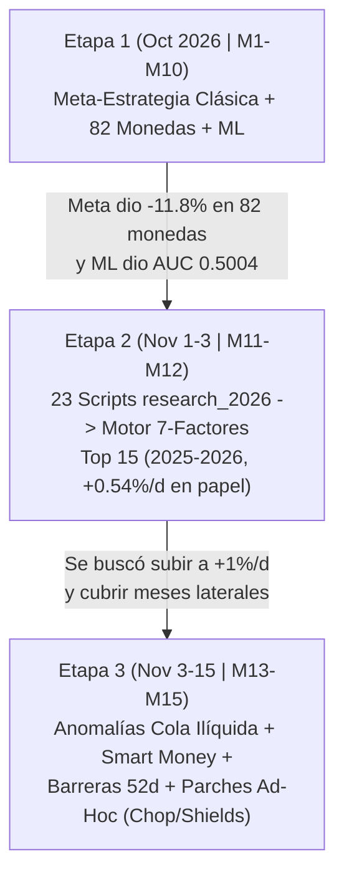

# Auditoría Forense de Investigaciones Pasadas (`M1–M15`) y Plan de Estudio General del Mercado (`82` Símbolos, `2023–2026`)

## 1. Mapa Completo de Qué se Investigó y Cómo se Decidió la Arquitectura Actual

Se revisaron los **11 reportes históricos** en `docs/` y `reports/`, los módulos huérfanos en `src/`, y los **23 scripts originales de investigación** (`scripts/research_2026/*.py`, recuperados del historial de Git previos al commit `565ee3c`). La evolución del sistema ocurrió en tres etapas claramente diferenciadas:

| Etapa | Qué se probó | Documentos / Scripts Fuente | Decisión tomada entonces |
| :--- | :--- | :--- | :--- |
| **1A. Universo 82 y Meta-Estrategia** | `Momentum` + `StatArb` + `Carry` en `Top 10` vs `82` monedas (`2023–2026`, `8h`, Maker `2 bps`). | [full_universe_simulation_report.md](file:///Users/santim/Projects/trading/crypto-alpha-engine/reports/full_universe_simulation_report.md) | Se descartó operar las `82` monedas porque `Meta-Strategy` dio `-11.81%` (`Sharpe 0.04`), restringiendo el Core a `Top 15`. |
| **1B. Pares Cointegrados por Sector** | `Engle-Granger` + `OU` + `Hurst < 0.45` sobre `39` pares sectoriales (`3.75` años). | [sector_cointegration_report.md](file:///Users/santim/Projects/trading/crypto-alpha-engine/reports/sector_cointegration_report.md), [cointegrated_pairs.py](file:///Users/santim/Projects/trading/crypto-alpha-engine/src/strategies/cointegrated_pairs.py) | Solo `1` de `39` pares (`RENDER/FET`) pasó estacionariedad (`Sharpe 0.28`). Quedó apagado (`--enable-pairs` en `False`). |
| **1C. Barras de Información y ML Meta-Labeling** | `Dollar Bars`, `Purged CV`, `Optuna LightGBM` + `Triple Barrier` (`10` monedas). | [information_bars_statistical_benchmark.md](file:///Users/santim/Projects/trading/crypto-alpha-engine/reports/information_bars_statistical_benchmark.md), [ml_meta_labeling_optuna_report.md](file:///Users/santim/Projects/trading/crypto-alpha-engine/reports/ml_meta_labeling_optuna_report.md) | El Meta-Clasificador dio **`AUC = 0.5004`** (azar puro) y bajó el Sharpe de `4.98` a `3.80`. Se abandonó toda la capa ML. |
| **1D. Microestructura, HRP y Arbitraje Cross-Exchange** | Ley de raíz cuadrada de impacto L2, `HRP` (Ward/Single) y `Binance-Bybit Perp-Perp`. | [market_impact_slippage_report.md](file:///Users/santim/Projects/trading/crypto-alpha-engine/reports/market_impact_slippage_report.md), [hrp_allocation_benchmark_report.md](file:///Users/santim/Projects/trading/crypto-alpha-engine/reports/hrp_allocation_benchmark_report.md), [perp_perp_arbitrage.py](file:///Users/santim/Projects/trading/crypto-alpha-engine/src/strategies/perp_perp_arbitrage.py) | Módulos excelentes construidos y testeados unitariamente, pero **desconectados** cuando se migró al motor 7-Factores. |
| **2. Estudio `1m–720h` y Motor 7-Factores** | Barrido de horizontes y alocador causal `t-stat` online sobre `Top 15` (`22` meses: `2025-01` a `2026-10`). | [high_frequency_and_alpha_research_2026.md](file:///Users/santim/Projects/trading/crypto-alpha-engine/reports/high_frequency_and_alpha_research_2026.md) + `23` scripts en `commit adb3fb9` | Reemplazó a la Meta-Estrategia por [seven_factor_engine.py](file:///Users/santim/Projects/trading/crypto-alpha-engine/src/strategies/seven_factor_engine.py) + `SteppedLeverage` (`+0.54%/d`, `Sharpe 4.74` reportado). |
| **3. Anomalías de Cola Ilíquida y Barreras (`52d`)** | `OversoldBounce`, `EarlyBreakout`, `PumpFundingFade` (`183d` en `23` monedas) + matriz de `14` barreras en `52d`. | [backtest_anomaly_illiquid_report.md](file:///Users/santim/Projects/trading/crypto-alpha-engine/reports/backtest_anomaly_illiquid_report.md), [SYSTEM_OPERATION_AND_DECISIONS_2026.md](file:///Users/santim/Projects/trading/crypto-alpha-engine/docs/SYSTEM_OPERATION_AND_DECISIONS_2026.md) | Se adoptó `TP +5%` + `Profit-Lock 3.5->1.5%` sin SL; las anomalías sangraron en vivo y terminaron apagadas. |

---

## 2. Auditoría Metodológica: ¿Se Hizo Bien? (Las 7 Fallas Críticas Encontradas)

Al auditar el código exacto con el que se corrieron aquellas pruebas, la respuesta honesta es que **hubo aciertos teóricos muy valiosos, pero 7 errores metodológicos graves sesgaron las conclusiones** (haciendo descartar minas de oro reales e inflando expectativas en papel):

> [!WARNING]
> **Las 3 Ideas Potentes que Fueron Descartadas por Bugs en los Propios Tests (Falsos Negativos):**

1. **El Universo de `82` Monedas y la Meta-Estrategia fueron saboteados por dos sub-estrategias defectuosas:**
   - En [full_universe_simulation_report.md](file:///Users/santim/Projects/trading/crypto-alpha-engine/reports/full_universe_simulation_report.md#L33-L36), `StatArbMeanReversion` tuvo **`0.0x` rotación (`0` operaciones en `3.75` años)** porque [stat_arb_mean_reversion.py](file:///Users/santim/Projects/trading/crypto-alpha-engine/src/strategies/stat_arb_mean_reversion.py#L65-L83) calculaba el exponente de Hurst sobre apenas `72` precios crudos (donde el estimador tiene sesgo positivo $\approx 0.56$ y casi nunca baja de `0.45`).
   - Al mismo tiempo, [funding_carry_arbitrage.py](file:///Users/santim/Projects/trading/crypto-alpha-engine/src/strategies/funding_carry_arbitrage.py#L87-L95) operó **Carry direccional sin cobertura** en las 82 monedas (`Short` la moneda en pleno *short-squeeze* con funding alto y `Long` la moneda muriendo con funding negativo), perdiendo **`-74.97%` (`MaxDD 87.55%`)**.
   - Como la Meta-Estrategia promediaba ambas, dio `-11.81%` y se culpó a "las 82 monedas", **ignorando que en esa misma tabla `Cross-Sectional Momentum` subió de `+38.20%` (Top 10) a `+47.64%` (82 monedas)** aún sin neutralizar beta ni filtrar liquidez.

2. **La Cointegración de Pares falló porque se probó sobre precios nominales con $\beta$ fijo de 4 años:**
   - En [cointegrated_pairs.py](file:///Users/santim/Projects/trading/crypto-alpha-engine/src/strategies/cointegrated_pairs.py#L105-L123) y [sector_cointegration_report.md](file:///Users/santim/Projects/trading/crypto-alpha-engine/reports/sector_cointegration_report.md#L28-L38), se ajustó OLS sobre precios en dólares (`P_y - beta * P_x`) y en el reporte se exigió estacionariedad con un único $\beta$ fijo durante `3.75` años (`2023–2026`). En cripto, la cointegración real ocurre en **log-precios ($\ln P_y - \beta_t \ln P_x$) con razón de cobertura adaptativa (Filtro de Kalman)**. Por ese error de especificación se rechazaron `38` de `39` pares.

3. **El ML Meta-Labeling (`AUC = 0.5004`) nunca usó las `Dollar Bars` que el propio proyecto construyó:**
   - Se construyeron [dollar_bars.py](file:///Users/santim/Projects/trading/crypto-alpha-engine/src/features/dollar_bars.py) y [basket_dollar_bars.py](file:///Users/santim/Projects/trading/crypto-alpha-engine/src/features/basket_dollar_bars.py) demostrando normalidad gaussiana (`p = 0.74`), pero `train_ml_meta_pipeline.py` entrenó sobre barras horarias comunes de solo `10` monedas con etiquetas de `24h` solapadas en un `97%` (`uniqueness = 0.0296`).

> [!CAUTION]
> **Los 4 Sesgos que Inflaron Expectativas en `research_2026` y Anomalías (Falsos Positivos):**

4. **Fricción irreal (`100% Maker a 2 bps`, `0` slippage, `0` selección adversa) y retorno aritmético:**
   - En los scripts `refine_22m_allocator_and_stepped_lev.py` y `explore_high_return_strategies.py` (`commit adb3fb9`), se asumió que el `100%` del giro se llenaba a `fee_rate = 0.0002` sin perder rupturas y **sin conectar el modelo `NonLinearMarketImpactModel`** de [market_impact.py](file:///Users/santim/Projects/trading/crypto-alpha-engine/src/features/market_impact.py), además de reportar `daily_ret.mean()` (media aritmética, que a `4x–5x` exagera el compuesto geométrico) y usar `.bfill()` en activos no listados aún (`RENDERUSDT` pre-julio 2024).
5. **Ajuste *In-Sample* iterativo sobre la misma ventana (`2025–2026`) y ventanas cortas (`52 días`):**
   - Los 23 scripts de `research_2026` y los parches posteriores (`is_knife`, `is_rocket`, `Lone-Macro`, `Lone-Rev`, `Chop Range-Arb`, y las `14` barreras en `52` días) se diseñaron inspeccionando directamente los meses flojos del propio dataset de evaluación, sin separación estricta *Train / Validation / Holdout*.
6. **Desconexión entre lo investigado (`8h`) y lo desplegado (`4h`):**
   - En `test_online_factor_allocator_22m.py` y `refine_22m_allocator_and_stepped_lev.py`, las pruebas ganadoras usaban **`reb_hours = 8`**, pero en `run_trading.py` se desplegó con `14400s` (`4h`), duplicando la rotación en vivo (corregido hoy en `2bf7ac9`).
7. **Anomalías promovidas pese a perder `-52.4%` en su propio backtest:**
   - En [backtest_anomaly_illiquid_report.md](file:///Users/santim/Projects/trading/crypto-alpha-engine/reports/backtest_anomaly_illiquid_report.md#L10-L19), el modo producción terminó con `-52.42%` (`Profit Factor 0.67`) usando umbrales fijos arbitrarios (`-15%`, `RSI < 28`, `+25%`) y `0%` slippage sobre monedas volátiles; parecía "mejor" solo porque el baseline roto perdía `-60.28%`.

---

## 3. La Gran Oportunidad No Explorada: Nuestra Ventaja de Capital Ágil (`$3k–$15k`) en los 82 Símbolos

Tu intuición sobre **estudiar primero el mercado general por escenarios** y **evaluar el universo completo / cola menos líquida** da exactamente en el clavo por una razón microestructural concreta:

> [!IMPORTANT]
> **Por qué la cola media/ilíquida (`Símbolos 16 al 82`) falló ayer cuando la metimos cruda en el mismo saco, pero puede ser una fuente enorme de alpha con el mecanismo correcto:**
> - Con un capital de **`$2,700 – $15,000`**, una posición individual nuestra es de **`$150 a $600 USD`**.
> - Según la Ley de Raíz Cuadrada ya calibrada en [market_impact_slippage_report.md](file:///Users/santim/Projects/trading/crypto-alpha-engine/reports/market_impact_slippage_report.md#L36-L45), un fondo institucional de `$5M` **no puede tocar** monedas que operan `$5M–$25M/día` (`PENDLE, RUNE, INJ, TAO, KSM, ZEC, ENJ, CHZ, GALA, PYTH, JUP, ENA...`), por lo que allí **las ineficiencias de precio, dispersión transversal y excesos de funding duran mucho más tiempo**.
> - Ayer, cuando metimos `32` monedas de golpe en `SevenFactorOnlineEngine`, falló por **tres razones técnicas corregibles**: (a) las monedas nuevas no estaban mapeadas en `ALT_SECTOR_CLUSTERS`, (b) una moneda ilíquida con volatilidad rara o *short-squeeze* podía recibir el mismo techo de peso (`30%` del lado = `$1,200`) que `BTC`, y (c) el mismo motor intentaba aplicarles las mismas reglas que a `BTC/ETH`.

---

## 4. Propuesta: Estudio General del Mercado, Regímenes y los 82 Símbolos (Desde Primeros Principios)

Antes de escribir o modificar una sola línea más de código productivo, propongo ejecutar una **investigación fundacional limpia y sin sesgos** sobre los **`82` contratos perpetuos completos de Google Drive (`2023-01-01` a `2026-11-17`, `~2.7 millones` de barras horarias)** dividida en **4 Fases**:

### Fase 1 — Anatomía Empírica del Mercado Cripto y Mapa de Escenarios (`2023–2026`)
Clasificar objetivamente los `~1,415` días de historia usando **variables de estado estrictamente causales**:
1. **Dirección y Volatilidad del Ancla (`BTC`):** Tendencia alcista suave, Parabólica, Lateral, Corrección o Cascada de Liquidación.
2. **Dispersión Transversal y Correlación Media (`CS-Dispersion` & $\bar{\rho}$):** Cuándo las altcoins se separan entre ganadoras/perdedoras vs. cuándo todo se mueve en bloque (`beta = 1`).
3. **Régimen de Derivados (`Funding Medio` y `Dispersión de Funding`):** Contango sano, Euforia apalancada retail (`> +30% APR`), o Backwardation / pánico corto (`< -10% APR`).
4. **Autocorrelación Transversal (`CS-AutoCorr`):** Qué porcentaje del tiempo el mercado premia **Continuación (Momentum)** vs. **Reversión (Mean-Reversion)** en horizontes de `1h`, `4h`, `8h`, `24h` y `72h`.

### Fase 2 — Radiografía por Tier de Liquidez (`82` Símbolos con Costos Reales por Moneda)
Dividir dinámicamente (sin *survivorship bias*, usando solo volumen rodante previo de `30d`) los `82` símbolos en **4 Tiers**:
- **Tier 1 (`Mega-Caps`, Top 5):** `BTC, ETH, SOL, BNB, XRP`
- **Tier 2 (`Large-Caps`, Rank 6–20):** `DOGE, ADA, AVAX, LINK, SUI, APT, NEAR, LTC, BCH, UNI...`
- **Tier 3 (`Mid-Caps`, Rank 21–45):** `INJ, TAO, OP, ARB, AAVE, TIA, WLD, PENDLE, FIL, RUNE, FET, JUP, ENA...`
- **Tier 4 (`Cola Ilíquida / High-Beta`, Rank 46–82):** `MAGIC, CTSI, OGN, SKL, GTC, KSM, RLC, ZEC, MEME, CHZ...`

En cada Tier mediremos: **dispersión bruta disponible**, **spread efectivo real (`Corwin-Schultz` hora por hora)**, **impacto real de una orden nuestra de `$250–$600` (`NonLinearMarketImpactModel`)**, y **prima neta real después de costos reales**.

### Fase 3 — Matriz "Qué Mecanismo Gana en Qué Escenario y en Qué Tier"
Probar familias de mecanismos **puras y simples** (pocos grados de libertad, partición estricta *Train `2023–2024` / Validation `2025` / Holdout Sellado `2026`*) cruzadas contra los escenarios de Fase 1 y los Tiers de Fase 2:
1. **Momentum Idiosincrático Multi-Horizonte** (¿funciona mejor en Tier 2–3 con topes pequeños por moneda de `5%–8%` para que ningún *squeeze* individual dañe la cartera?).
2. **Stat-Arb de Pares y Canastas Sectoriales en `Log-Precios` con Filtro de Kalman Dinámico** (`1h–4h`, reparando la falla de especificación de `M7`).
3. **Mecanismos Específicos para Cola Media/Ilíquida (Tier 3–4):**
   - *Post-Exhaustion Mean-Reversion* (agotamiento tras velas `> 3 sigma` + colapso de volumen/funding, entrando **solo con órdenes límite pasivas escalonadas** en vez de perseguir a mercado y con riesgo máximo `2%–3%` por idea).
   - *Breakout de Compresión Silenciosa* (expansión de volumen desde baja volatilidad antes de que el spread se abra).
4. **Carry y Estructura Temporal (`Funding Crowding` / `Spot-Perp` / `Binance-Bybit Spread`):** Cuándo cosechar funding de forma `100%` delta-neutral.

### Fase 4 — Reconstrucción de una Verdadera Meta-Estrategia Heterogénea (`HRP` / Régimen)
Si encontramos **2 o 3 motores genuinamente ganadores en escenarios distintos** (por ejemplo: *Core Cross-Sectional `8h`* en tendencias/dispersión + *Kalman Log-Pairs `2h`* en rangos laterales + *Especialista Diversificado de Mid-Caps/Cola con cap del `5%` por moneda*), asignarlos mediante el alocador [`HierarchicalRiskParity`](file:///Users/santim/Projects/trading/crypto-alpha-engine/src/risk/hrp_allocator.py) condicionado al escenario de mercado detectado en Fase 1, validando la ganancia real sobre el *Holdout 2026* intacto.
