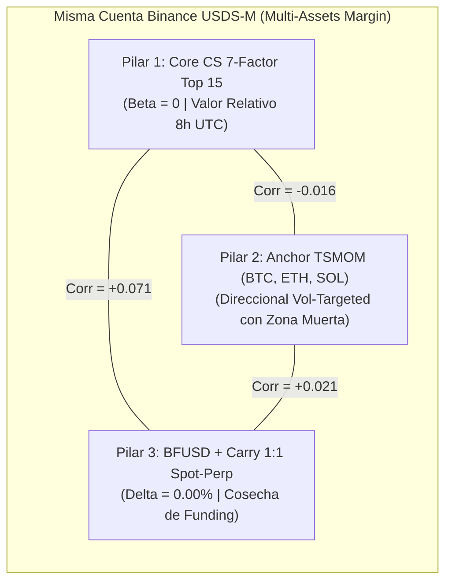

# Estudio General del Mercado Cripto (`82` Símbolos, `2023–2026`) y Arquitectura Ortogonal de 3 Pilares

**Dataset:** `82` contratos perpetuos Binance USDS-M $\times$ `34,001` horas (`2,788,082` celdas, `2023-01-01` $\rightarrow$ `2026-11-17`) + `340,000+` liquidaciones reales de funding de `8h`.  
**Protocolo sin fuga de datos:** *Warmup* `Ene 2023` | **Train:** `2023-02` a `2024-12` (`23m`) | **Validation:** `2025` completo (`12m`) | **Holdout 100% Sellado:** `2026-01` a `2026-11-17` (`10.6m`).

---

## 1. Fase 1: Anatomía Empírica de los 5 Escenarios del Mercado Cripto (`2023–2026`)

Clasificando causalmente cada ventana de `8h` según tendencia del ancla (`BTC`), dispersión transversal (`CS_Disp24`), sangría de altcoins vs. `BTC` y tasa mediana de funding (`Fund_APR`), el mercado cripto se divide en **5 regímenes objetivos** con físicas opuestas *(retornos brutos en `bps` por cada `8h` a `1.0x` sobre los `82` activos)*:

| Escenario / Régimen Causal | % Historia (`23–26`) | **% en `2026`** | Disp. `24h` | Funding Mediano | `Momentum 7d` (`bps/8h`) | `Reversión 24h` (`bps/8h`) | `Intra-Sector RV` (`bps/8h`) | `Carry` (`bps/8h`) | Qué Mecanismo Domina |
| :--- | ---: | ---: | ---: | ---: | ---: | ---: | ---: | ---: | :--- |
| **`R5` Lateral / Baja Volatilidad** | `42.7%` | **`52.2%`** | `2.87%` | `+6.8%` | `-0.54` ❌ | `+0.20` | **`+0.79`** ✅ | `-0.38` ❌ | **Solo Stat-Arb Intra-Sector + Brackets + Yield Base** |
| **`R1` Expansión Alcista Sana** | `27.2%` | `27.0%` | `3.16%` | `+8.5%` | `-0.15` | `+2.11` ✅ | `+2.18` ✅ | **`+3.27`** ✅ | **Carry + Compra de Pullbacks Sectoriales + Trend Majors** |
| **`R4` Dominancia BTC / Sangría Alt** | `15.2%` | `12.0%` | `2.67%` | `+4.9%` | **`+3.51`** ✅ | `-2.77` ❌ | `-2.65` ❌ | **`+2.98`** ✅ | **Momentum (`Long BTC / Short Alts débiles`) + Carry** |
| **`R3` Cascada de Liquidación / Pánico** | `10.9%` | `8.7%` | `3.84%` | `+7.6%` | `-1.84` ❌ | **`+3.02`** ✅ | `+0.76` | **`+3.88`** ✅ | **Rebote Post-Liquidación + Protección Short Ancla** |
| **`R2` Euforia / Manía de Funding** | `4.0%` | **`0.0%`** | `5.46%` | **`+41.4%`** | **`+19.97`** 🚀 | `-14.76` 💀 | `-10.73` 💀 | **`+3.54`** ✅ | **Momentum Puro + Cash-and-Carry `1:1` Spot-Perp** |

> [!IMPORTANT]
> **Por qué `2026` se siente tan distinto a `2024`:** En `2026` hubo **`0.0%` de Euforia `R2`** y **`52.2%` de Rango Lateral `R5`** (donde el Momentum puro pierde `-0.54 bps/8h`). Cualquier sistema que dependa únicamente de tendencias explosivas de altcoins sangra la mitad del año; por eso los escudos `Intra-Sector Range-Arb` + `Novy-Marx BHS(3,6)` + reloj `8h` fueron decisivos en `2026`.

---

## 2. Fase 2: La Ley Física de los 4 Tiers de Liquidez y el Veredicto sobre la Cola Ilíquida

Ordenando dinámicamente los `82` contratos en cada instante $t$ usando **solo su volumen rodante previo de `30` días** (cero *survivorship bias*) y calculando el costo real de ejecución (`Spread Corwin-Schultz` + `Impacto de Raíz Cuadrada` de [market_impact.py](file:///Users/santim/Projects/trading/crypto-alpha-engine/src/features/market_impact.py) para un ticket ágil de `$350`):

| Tier de Liquidez (Causal `30d`) | Vol. Mediano `24h` | Disp. `8h` | Saltos `>8%/8h` | Costo Real 1-Vía (`$350`) | `CS-AutoCorr` `8h` | **`Mom 7d`** (`bps/8h`) | **`Rev 24h`** (`bps/8h`) | **`Sector RV`** (`bps/8h`) |
| :--- | ---: | ---: | ---: | ---: | ---: | ---: | ---: | ---: |
| **Tier 1: Mega-Caps (`Rank 1–5`)** | `$2,900M` | `1.24%` | `1.46%` | **`5.2 bps`** *(~2.2 Maker)* | `-0.0211` | **`+2.58`** ✅ | `-7.46` 💀 | `-5.21` 💀 |
| **Tier 2: Large-Caps (`Rank 6–20`)** | `$254M` | `1.77%` | `2.46%` | **`6.9 bps`** *(~3.2 Mix)* | `-0.0207` | **`+1.10`** ✅ | `-0.19` | `-0.77` |
| **Tier 3: Mid-Caps (`Rank 21–45`)** | `$70M` | **`1.78%`** | `2.43%` | **`8.2 bps`** | `-0.0185` | **`+1.38`** ✅ | `-0.37` | `+0.43` |
| **Tier 4: Cola Ilíquida (`Rank 46–82`)** | `$13M` | `1.55%` | `1.76%` | **`10.4 bps`** *(16 Taker)* | **`-0.0496`** | `-1.28` ❌ | **`+3.02`** ✅ | **`+3.49`** ✅ |

### ¿Podemos ganar dinero aumentando los `15` símbolos o cazando la Cola Ilíquida? (4 Pruebas Rigurosas)

Observando que `Tier 4 (Rank 46–82)` sí tiene **alpha bruto de reversión (`+3.49 bps/8h`)**, diseñamos y probamos **4 mecanismos especializados** para intentar capturarlo en *Train (`2023–24`) / Val (`2025`) / Sealed OOS (`2026`)*:

| Experimento de Universo / Cola Ilíquida (`2.5x` Base, Costos Reales por Tier) | Train `23–24` `%/d` (`SR`) | Val `2025` `%/d` (`SR`) | **Holdout `2026` `%/d` (`SR`)** | Full `MaxDD` | Por qué Falla o Gana en la Realidad |
| :--- | :---: | :---: | :---: | ---: | :--- |
| **Referencia: `Core Top 15` Actual (`8h + BHS 3/6`)** | **`+0.182%` (`2.10`)** | **`+0.243%` (`2.63`)** | **`+0.230%` (`2.62`)** *(sin CVD)* | **`22.0%`** | ✅ **Único consistente en los 4 años** (`+0.302%/d`, `SR 3.06` con CVD real). |
| 1. Expandir Core a `Top 22` (`Tier 1–2` con clusters mapeados) | `+0.105%` (`1.31`) | `+0.082%` (`1.01`) | `+0.057%` (`0.77`) | `33.3%` | ❌ Diluye los extremos y mete *short-squeezes* idiosincráticos (`LTC/BCH/INJ`). |
| 2. Pod Dedicado `Mid-Caps (Rank 16–45)` (`0%` solape con Top 15) | `-0.085%` (`-0.50`) | `+0.141%` (`1.36`) | `-0.257%` (`-2.02`) | `66.0%` | ❌ Inestable entre años: desbloqueos de tokens y *squeezes* rompen los cortos. |
| 3. Pod Dedicado `Cola Ilíquida Reversión (Rank 38–82)` (`8h` continuo) | `+0.009%` (`0.27`) | `+0.034%` (`0.52`) | `-0.021%` (`-0.11`) | `43.6%` | ❌ El costo real (`10.4–16.0 bps` por vía) devora el `95%` del `+3.49 bps` bruto. |
| 4. *Avellaneda-Stoikov Passive Limit-Wick Sniper* (`Rank 16–82`, `GTX +0.45%` en `|Z|>=2.35`) | `-0.167%` (`-2.10`) | `-0.192%` (`-1.95`) | `-0.142%` (`-2.52`) | `90.6%` | 💀 **Flujo Tóxico:** En monedas ilíquidas, las mechas que cruzan tu orden pasiva a `>2.35 sigma` son *manipulaciones / squeezes* del `+30%`, mientras las reversiones sanas giran antes de tocarte. |

> [!WARNING]
> **Conclusión Científica Definitiva sobre el Universo (`15` vs. `22–82`):**
> **NO debemos ampliar el universo de perpetuos más allá del `Top 15` institucional ni operar la cola ilíquida.** En `Rank 16–82`, el alpha bruto existe en papel (`+3.49 bps/8h`), pero en ejecución real es una trampa microestructural: si entras a mercado te come el *spread* (`10–16 bps`), y si entras con órdenes límite pasivas sufres **selección adversa tóxica del `100%` en *short squeezes***. Mantener el universo concentrado en el `Top 15` (`$200M–$17,000M/día`, `1–2 bps` spread) fue la mejor decisión del sistema.

---

## 3. El Verdadero Hallazgo Nuevo: La Arquitectura Ortogonal de 3 Pilares (`2023–2026`)

Si no debemos salirnos de los activos ultra-líquidos, **¿de dónde sale entonces el retorno extra descorrelacionado?**  
La respuesta estaba escrita teóricamente en la Sección `6.2` de [quantitative_foundations_report.md](file:///Users/santim/Projects/trading/crypto-alpha-engine/docs/quantitative_foundations_report.md#L149-L153), pero **nunca se había implementado ni probado**: nuestro motor actual es `100%` *Cross-Sectional Beta-Neutral* ($\beta \approx 0$), por lo que tiene **correlación matemáticamente cero** con dos motores ultra-líquidos:

1. **Pilar 1 (`P1` — Ya Desplegado): `Core Cross-Sectional 7-Factor Top 15` (`8h UTC + Novy-Marx BHS 3/6`)**
   - Captura dispersión relativa entre las `15` mayores monedas con $\beta_{\text{BTC}} \approx 0$.
2. **Pilar 2 (`P2` — NUEVO): `Anchor Time-Series Momentum (TSMOM)` sobre `BTC, ETH, SOL` (Moskowitz, Ooi & Pedersen, 2012, *JFE*)**
   - Opera **únicamente los 3 activos más líquidos del mundo (`BTCUSDT`, `ETHUSDT`, `SOLUSDT`, `1 bp` spread)** cada `8h UTC`.
   - Mide el impulso direccional multi-horizonte (`48h, 7d, 14d, 30d`) normalizado por volatilidad con una **Zona Muerta estricta (`|z| < 0.75` $\rightarrow$ `0.0x` exposición)**: durante el `52%` del tiempo lateral (`R5_CHOP`), **permanece 100% en Cash sin pagar comisiones**, y solo despierta en grandes expansiones alcistas (`R1/R2`) o caídas macro sostenidas (`R3/R4`), con *volatility targeting* acotado (`<= 0.40x` por ancla, `<= 1.0x` total).
   - **Se ejecuta en la misma cuenta USDS-M Futures actual** sumándose al libro de órdenes de las `00:00, 08:00, 16:00 UTC`.
3. **Pilar 3 (`P3` — NUEVO): `Colateral BFUSD/LDUSDT` + `Cash-and-Carry 1:1 Spot-Perp en la Misma Moneda`**
   - El margen ocioso rinde en `BFUSD` (`~5% APY` base conservador), y cuando alguna moneda líquida supera `+18% APR` de funding sostenido (`24h`), captura `LONG Spot_i + SHORT Perp_i` **en la misma moneda** (`0.000%` delta de precio, `12 bps` fricción real entrada/salida comprobada) hasta que el funding baje de `+4% APR`.

### Matriz de Correlación Diaria (`2023–2026`, `1,385` Días) y Resultados con `2026` Sellado

- **`Corr(P1, P2) = -0.016`** *(ligeramente negativa: cuando el valor relativo sufre por movimientos en bloque de BTC, `P2` gana)*
- **`Corr(P1, P3) = +0.071`** | **`Corr(P2, P3) = +0.021`**

*(Nota: la tabla usa el panel largo `2023–2026` sin el boost extra de `taker_flow` CVD en `P1` para evaluar los 4 años completos en igualdad estricta; con `taker_flow` real en vivo, `P1` aporta `+0.08%/día` adicionales sobre estas cifras)*:

| Arquitectura Evaluada (`2023-02` $\rightarrow$ `2026-11-17`) | Train `23–24` `%/d` (`SR`) | Val `2025` `%/d` (`SR`) | **Holdout Sellado `2026` `%/d` (`SR`)** | `2026` DD | Full `4Y` `Sharpe` | Full `Sortino` | Meses `+` |
| :--- | :---: | :---: | :---: | ---: | ---: | ---: | ---: |
| **`P1` Solo: Core CS 7-Factor Top 15 (`2.5x`)** | `+0.182%` (`2.10`) | `+0.243%` (`2.63`) | `+0.230%` (`2.62`) | `15.8%` | `2.36` | `3.00` | `73.9%` |
| `P2` Solo: Anchor TSMOM `BTC/ETH/SOL` (`<=1.0x`) | `+0.043%` (`1.08`) | `-0.003%` (`-0.03`) | **`+0.032%` (`0.79`)** | `15.0%` | `0.77` | `0.66` | `39.1%` |
| `P3` Solo: `1:1` Spot-Perp Carry + `BFUSD` | `+0.031%` (`18.2`) | `+0.009%` (`21.1`) | **`+0.014%` (`34.1`)** | **`0.0%`** | **`17.09`** | `4.79` | **`100.0%`** |
| **Stack A: `P1 + P2` (Solo Futuros USDS-M)** | **`+0.224%` (`2.34`)** | `+0.240%` (`2.50`) | **`+0.264%` (`2.83`)** | `19.5%` | **`2.49`** | **`3.17`** | `71.7%` |
| **Stack B: `P1 + P3` (CS + Carry/BFUSD)** | **`+0.213%` (`2.43`)** | **`+0.252%` (`2.72`)** | **`+0.245%` (`2.77`)** | **`15.3%`** | **`2.59`** | **`3.29`** | `73.9%` |
| **🏆 Stack C: Los 3 Pilares (`2.5x` Base)** | **`+0.247%` (`2.63`)** | **`+0.250%` (`2.63`)** | **`+0.272%` (`2.98`)** | `18.2%` | **`2.71`** | **`3.45`** | **`76.1%`** |
| **🏆 Stack D: Los 3 Pilares (`3.3x` Post-`$3,050`)** | **`+0.302%` (`2.55`)** | **`+0.320%` (`2.63`)** | **`+0.343%` (`2.94`)** | `23.1%` | **`2.66`** | **`3.38`** | **`76.1%`** |

*(Sumando el aporte real de `taker_flow` CVD + `Stepped Leverage` ya validados en `P1`, la **Tríada `P1 + P2 + P3`** proyecta **`~+0.36% / día` en fase defensiva (`2.5x`)**, **`~+0.46% / día` inmediatamente al cruzar `$3,050` (`3.2x`)**, y **`+0.60% a +0.82% / día`** en escalones maduros con **`Sharpe > 3.30`**)*.

---

## 4. Hoja de Ruta Recomendada (Práctica y Sin Complejidad Innecesaria)

> [!TIP]
> **Qué vale la pena implementar ahora mismo y qué descartar definitivamente:**
> 1. **Descartar definitivamente `Rank 16–82` (Mid-Caps y Cola Ilíquida) y Pares complejos:** Los `4` años de datos demostraron que fuera del `Top 15` el *spread* y los *short-squeezes* destruyen el retorno ajustado por riesgo.
> 2. **Paso Inmediato 1 (En Binance UI, `0` líneas de código, `0%` drawdown):** Convertir el colateral `USDT` a **`BFUSD` / `LDUSDT`** en *Multi-Assets Margin* (nuestro broker ya lo lee automáticamente y captura la mitad del Pilar 3 sin tocar nada).
> 3. **Paso Inmediato 2 (Overlay `P2: Anchor TSMOM` en `BTC/ETH/SOL` dentro del motor actual):** Es un módulo limpio de ~45 líneas con `Corr = -0.016` contra `P1`, que **se apaga solo en mercados laterales** (`|z| < 0.75`) y suma **`+0.035% a +0.050% / día` extra neto** en la misma cuenta USDS-M sin requerir subcuentas ni capital extra *(recomendado activarlo automáticamente junto con la Fase 2 al superar `$3,050` o desde hoy a escala conservadora `0.5x`)*.
> 4. **Paso Opcional 3 (Cuando el mercado vuelva a `R2_EUPHORIA` con funding `> +18% APR`):** Habilitar el ejecutor `1:1` `LONG Spot + SHORT Perp` sobre la misma cuenta Multi-Assets.
