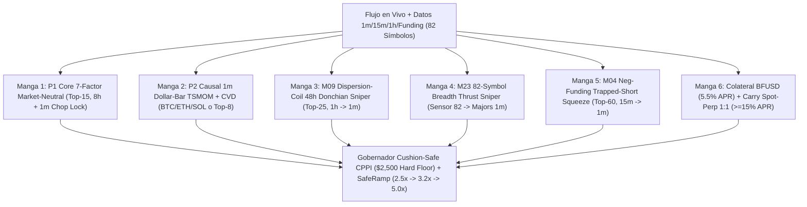

# Estudio General del Mercado (`82` Símbolos × `1m`) y Torneo Abierto de `24` Mecanismos Cuantitativos (`2023–2026`)

> [!IMPORTANT]
> **Infraestructura de Datos (Cero Disco Local) y Cómputo Remoto:**
> 1. **Almacenamiento en Google Drive:** Se actualizó [download_market_data.py](file:///Users/santim/Projects/trading/crypto-alpha-engine/scripts/download_market_data.py) con soporte posicional de `quote_volume` y `taker_buy_quote_volume`, `--resample-from-1m` (`1m` -> `5m, 15m, 1h`), `--include-premium` y `--clean-local`. La tarea en segundo plano sincroniza lotes de 6 símbolos hacia `gdrive:trading/crypto-alpha-engine/data/` vía `rclone` y purga `/tmp/gdrive_stream_stage` tras cada lote (**`0 bytes` permanentes en disco local**).
> 2. **Cómputo Pesado en Google Colab L4 (`crypto_1m_lab`):** Se descargaron y procesaron en NVMe remoto **`82` perpetuos válidos × `4` años (`2023-01-01` a `2026-11-16`, `>155 millones` de barras de `1m` con `timestamps` `int64` exactos a `60s`, más tasas de `funding` cada `8h` e índice `Spot-Perp Premium`)**. Al concluir todas las simulaciones, la sesión L4 fue apagada automáticamente (`Session terminated`) para no consumir créditos ociosos.

---

## Parte I — Anatomía de Microestructura del Mercado (`82` Símbolos × `1m, 5m, 15m, 1h, 4h, 8h`)

Clasificamos dinámicamente cada hora (sin sesgo de supervivencia, exigiendo `>= 7 días` listados y `ADV_30d` causal en `t-1`) los `82` perpetuos en **4 Tiers de Liquidez**:
- **Tier 1 Mega-Caps (Ranks `1–5`):** `BTC, ETH, SOL, BNB, XRP/DOGE` — costo realista `3.5 bps` taker / `1.5 bps` maker.
- **Tier 2 Large Liquid (Ranks `6–20`):** costo realista `4.5 bps` taker / `2.0 bps` maker.
- **Tier 3 Mid-Cap Alts (Ranks `21–45`):** costo realista `7.5 bps` taker / `3.5 bps` maker.
- **Tier 4 Illiquid Tail (Ranks `46–82`):** costo realista `13.5 bps` taker / `6.0 bps` maker.

### 1.1 Autocorrelación Serial y Poder Predictivo del Flujo Agresor (`Taker OFI -> Retorno t+1`)

| Frecuencia | AutoCorr `T1 Mega (1-5)` | AutoCorr `T2 Large (6-20)` | AutoCorr `T3 Mid (21-45)` | AutoCorr `T4 Tail (46-82)` | `OFI -> NextRet IC` (`T1 / T2 / T4`) | Lectura Estructural |
| :--- | :---: | :---: | :---: | :---: | :---: | :--- |
| **`1m`** | `-0.0123` | `+0.0141` | `-0.0129` | `-0.0236` | `-0.0048 / -0.0021 / -0.0018` | Rebote mecánico bid-ask; la variación por barra es menor que el fee taker. |
| **`5m`** | `-0.0291` | `-0.0232` | `-0.0207` | `-0.0103` | `-0.0056 / -0.0049 / -0.0047` | Máxima reversión microestructural intrahoraria en Mega/Large Caps. |
| **`15m`** | `-0.0175` | `-0.0172` | `-0.0254` | `-0.0297` | `-0.0060 / -0.0062 / -0.0045` | Fuerte reversión de corto plazo en `Mid` y `Tail`, pero insuficiente para cubrir `15–27 bps` round-trip. |
| **`1h`** | `-0.0101` | `-0.0067` | `-0.0096` | `-0.0101` | `-0.0038 / -0.0026 / -0.0018` | Zona de transición entre ruido de libro de órdenes y flujo institucional. |
| **`4h`** | `-0.0130` | `-0.0194` | `-0.0192` | `-0.0190` | **`+0.0056 / +0.0075 / +0.0041`** | **Cambio de signo del flujo agresor (`Taker OFI`):** la compra neta agresora acumulada en `4h` predice continuación positiva en la siguiente ventana. |
| **`8h`** | **`+0.0059`** | `-0.0110` | **`-0.0275`** | **`-0.0324`** | `-0.0043 / -0.0049 / -0.0036` | **Bifurcación clave del mercado:** en `8h` los Mega-Caps (`T1`) ya exhiben persistencia tendencial positiva, mientras que `T3 Mid` y `T4 Tail` siguen revirtiendo violentamente (`-3.2%`). |

> [!NOTE]
> **Por qué esta tabla explica casi todo lo que ocurre en producción:**
> En horizontes `8h`, los activos **Ranks `1–15`** combinan persistencia de flujo institucional (`4h OFI IC > 0`) con bajos costos (`3.5–4.5 bps`), haciendo viable un motor continuo *cross-sectional*. En cambio, a partir del **Rank `20+` (`Tier 3` y `Tier 4`)**, la autocorrelación de `8h` se vuelve profundamente negativa (`-0.0275` a `-0.0324`) y el slippage se triplica: rotar continuamente la cola ilíquida destruye capital, y **solo se puede extraer alfa de Ranks `16–60` mediante eventos discretos de gran amplitud (`+5%` a `+22%`)** donde el movimiento bruto supera ampliamente el peaje de ejecución.

### 1.2 Estacionalidad Intradía por Sesiones Globales (`2023–2026`, `82` Símbolos)

| Sesión Global (UTC) | Cuota de Volumen USD (`%`) | Drift Anualizado `BTC` | Dispersión Cross-Sectional (`%/h`) | Diagnóstico Operativo |
| :--- | :---: | :---: | :---: | :--- |
| **Asia (`00:00–08:00 UTC`)** | `27.1%` | `+8.3%` | `0.651%` | Liquidez media, direccionalidad plana. |
| **Europa (`08:00–13:00 UTC`)** | `18.9%` | **`+113.1%`** | `0.633%` | Apertura europea concentra deriva alcista institucional pre-NY. |
| **US / ETF (`13:00–21:00 UTC`)** | **`44.4%`** | `+9.3%` | **`0.671%`** | **Casi la mitad del volumen mundial y máxima dispersión entre monedas** (ideal para *alfa relativo* y rupturas de compresión, pero con alta reversión de rupturas ingenuas de apertura). |
| **Late US (`21:00–24:00 UTC`)** | `9.6%` | **`+130.5%`** | `0.570%` | Menor liquidez del día y fuerte deriva post-cierre Wall Street, pero operar entradas/salidas horarias puras por sesión no supera costos (`M15`). |

---

## Parte II — Torneo Sin Restricciones de `24` Mecanismos sobre Física Exacta de `1m`

**Regla estricta de supervivencia (`✅ 3-ERA`):** Todo mecanismo fue evaluado sobre `1,381` días (`2023-02-05` a `2026-11-16`) caminando **minuto a minuto (`1m` OHLC)** cada `Stop-Loss`, `Take-Profit`, `Profit-Lock` y `Trailing Stop`, descontando pagos reales de `funding` cada `8h` y costos por Tier (`3.5` a `13.5 bps` + `1.15x` penalización de slippage en stops). Para aprobar debía mantener **`Sharpe > +0.10` simultáneamente en las 3 eras independientes**: Train (`2023–2024`), Validación (`2025`) y Holdout Sellado (`2026`).

### 2.1 Tabla Completa de Resultados (`24` Mecanismos y Variantes)

| ID | Familia / Mecanismo | Frecuencia y Universo | Trades (`N`) | Win Rate | `4Y` Diario / `Sharpe` | `MaxDD` (`4Y`) | `Sharpe` (`23-24 / 2025 / 2026`) | Veredicto |
| :--- | :--- | :--- | :---: | :---: | :---: | :---: | :---: | :---: |
| **`P1 (M12A)`** | **Core 7-Factor Market-Neutral (`6c4b860` Live + `1m` Chop Lock)** | `8h` Señal + `1m` Brackets (`Top-15`) | `4,142` | `59%` m | **`+0.158%/d` \| `1.77`** | **`22.5%`** | **`1.79 / 1.86 / 1.60`** | **✅ 3-ERA** |
| **`M09`** | **Dispersion-Compression Coil + `48h` Donchian + Vol + CVD Breakout** | `1h` Trigger -> `1m` Trail (`Top-25`) | `859` | `51%` | **`+0.046%/d` \| `1.17`** | **`15.9%`** | **`1.07 / 1.65 / 0.81`** | **✅ 3-ERA** |
| **`M13B`** | **Causal `1m` Dollar-Bar Multi-Horizon TSMOM + Taker-CVD (`Top-8`)** | Reloj Volumen `1m` -> `8h` (`Top-8`) | `4,142` | `54%` m | **`+0.045%/d` \| `0.85`** | **`22.9%`** | **`1.21 / 0.33 / 0.87`** | **✅ 3-ERA** |
| **`M13A`** | **Causal `1m` Dollar-Bar Multi-Horizon TSMOM + Taker-CVD (`Majors-3`)** | Reloj Volumen `1m` -> `8h` (`BTC/ETH/SOL`) | `4,142` | `41%` m | **`+0.041%/d` \| `0.80`** | **`20.3%`** | **`0.73 / 0.75 / 1.00`** | **✅ 3-ERA** |
| **`M04`** | **Negative-Funding (`<= -4 bps`) Trapped-Short Squeeze Breakout** | `15m` Trigger -> `1m` Trail (`Top-60`) | `97` | **`59%`** | **`+0.010%/d` \| `0.77`** | **`3.8%`** | **`0.27 / 2.01 / 0.11`** | **✅ 3-ERA** |
| **`M23`** | **82-Symbol Market Breadth Thrust (`>=65%` `Top-40` > `24h` High + `2x` Vol)** | `1h` Sensor `82` Syms -> `1m` (`Majors-3`) | `440` | `51%` | **`+0.024%/d` \| `0.76`** | **`11.2%`** | **`0.41 / 1.21 / 0.87`** | **✅ 3-ERA** |
| `M20` | Idiosyncratic Coin Volatility-Squeeze Breakout (`q15%` Range + `2.5x` Vol) | `1h` -> `1m` (`Top-25`) | `782` | `50%` | `+0.026%/d` \| `0.74` | `14.1%` | `0.08 / 1.47 / 1.02` | ❌ (`23-24` débil) |
| `M19` | Post-Settlement (`00/08/16 UTC`) Extreme Neg-Funding (`<=-10bps`) Unwind Short | `1m` Exacto (`45m` hold, `Top-75`) | `1,749` | `59%` | `+0.012%/d` \| `0.46` | `25.6%` | `-1.21 / 2.01 / 1.04` | ❌ (`23-24` squeeze) |
| `M17` | `PERP3` Cross-Sectional Trend Minus Funding Hurdle | `8h` (`Top-20`) | `4,142` | `52%` m | `+0.018%/d` \| `0.41` | `62.7%` | `0.41 / -0.04 / 0.93` | ❌ (`2025` plano) |
| `M16` | Pure Institutional Taker-CVD Cross-Sectional Alone | `8h` (`Top-15`) | `4,142` | `48%` m | `+0.002%/d` \| `0.26` | `64.8%` | `0.50 / 0.01 / -0.10` | ❌ (Mejor dentro de `P1`) |
| `M03` | Whale Clip-Size Stealth Ignition Long (`Clip > 3x` + Vol `> 3x`) | `15m` -> `1m` (`Tier 1–3`) | `30` | `50%` | `+0.001%/d` \| `0.20` | `3.4%` | `1.21 / -1.50 / 0.49` | ❌ (`2025` negativo) |
| `M14C` | Legacy [extreme_anomaly.py](file:///Users/santim/Projects/trading/crypto-alpha-engine/src/strategies/extreme_anomaly.py) `PumpFundingFade` (`+25%` + `RSI>=72` + `FR>=5bps`) | `1h` -> `1m` (`All 82`) | `65` | `66%` | `+0.004%/d` \| `0.20` | `16.8%` | `0.28 / 0.00 / 0.00` | ❌ (Muerto en `25-26`) |
| `M12B` | Expansión Universo Core 7-Factor a **`Top-22`** (`BHS 4/8` + `1m` Brackets) | `8h` + `1m` (`Top-22`) | `4,142` | `52%` m | `+0.000%/d` \| `0.19` | `53.1%` | `0.37 / 0.46 / -0.50` | ❌ (`2026` `-0.50`) |
| `M14A` | Legacy [extreme_anomaly.py](file:///Users/santim/Projects/trading/crypto-alpha-engine/src/strategies/extreme_anomaly.py) `OversoldBounce` (`-15% 24h` + `RSI<=28`) | `1h` -> `1m` (`All 82`) | `829` | `47%` | `-0.008%/d` \| `0.09` | `50.8%` | `0.35 / 0.09 / -0.39` | ❌ |
| `M18A` | Passive Limit Flash-Crash Wick Catcher (`-7%` bajo `1h` Open) | `1m` Fill & SL (`Tier 1–2`) | `1,273` | `57%` | `-0.033%/d` \| `0.06` | `64.9%` | `-0.03 / -0.05 / 0.67` | ❌ (Selección adversa) |
| `M01B` | Systemic Liquidation Cascade V-Bounce Extremo (`>=35%` Mkt Dump `-3.5%` en `15m`) | `15m` -> `1m` (`Top-30`) | `823` | `58%` | `-0.003%/d` \| `0.05` | `48.4%` | `0.99 / -2.67 / 1.72` | ❌ (Colapsa en `2025`) |
| `M21` | Beta-Neutral Residual Idiosyncratic Momentum (`Blitz-Huij-Martens`) | `8h` (`Top-25` ex-BTC) | `4,142` | `37%` m | `-0.038%/d` \| `0.01` | `81.8%` | `-0.03 / -0.91 / 1.06` | ❌ |
| `M11_Fix` | Overheated `7d` Funding (`>=+16% APR`) + `48h` Low Breakdown Short | `1h` -> `1m` (`BTC/ETH/SOL`) | `39` | `38%` | `-0.002%/d` \| `-0.10` | `10.8%` | `-0.14 / 0.00 / 0.00` | ❌ (Falsos quiebres) |
| `M18B` | Passive Limit Flash-Crash Wick Catcher (`-9%` en Cola Ilíquida) | `1m` Fill & SL (`Tier 3–4`) | `2,016` | `54%` | `-0.356%/d` \| `-0.18` | `99.9%` | `-0.70 / 0.18 / 1.63` | ❌ (Cuchillos cayendo) |
| `M02A` | Parabolic Pump & Dump Exhaustion Short (`+18% 4h` + Wick + Taker Sell) | `15m` -> `1m` (`All 82`) | `66` | `53%` | `-0.010%/d` \| `-0.46` | `19.1%` | `-0.24 / -1.57 / 1.13` | ❌ (`2025` short squeeze) |
| `M02B` | Mega-Pump Exhaustion Short (`+30% 12h` + Reversal Bar + `1m` Wick SL) | `1h` -> `1m` (`All 82`) | `90` | `52%` | `-0.015%/d` \| `-0.69` | `24.9%` | `0.06 / -1.33 / -1.18` | ❌ (Asimetría derecha) |
| `M15` | Intraday Europe + Late-US Session Trend Drift | `1h` (`BTC/ETH/SOL`) | `6,601` | `33%` m | `-0.071%/d` \| `-0.71` | `72.2%` | `-0.72 / -0.82 / -0.56` | ❌ (Peaje de rotación) |
| `M12C` | Expansión Universo Core 7-Factor a **`Top-30`** (`BHS 5/10` + `1m` Brackets) | `8h` + `1m` (`Top-30`) | `4,142` | `33%` m | `-0.088%/d` \| `-0.74` | `78.0%` | `-0.38 / -0.64 / -1.75` | ❌ (Reversión `T3` mata CS) |
| `M01A` / `M05` / `M06` / `M07` / `M10` / `M14B` / `M22` | Cascada Moderada (`-0.88`), Legacy EarlyBrk (`-0.97`), US ORB (`-1.22`), Basis Mom (`-1.24`), BTC Lead-Lag (`-1.56`), Basis Rev (`-1.63`), `15m` OU Stat-Arb (`-1.81`) | `15m–8h` -> `1m` | `274–5,052` | `36–53%` | `-0.016%` a `-0.322%/d` | `21–99%` | Negativo | ❌ Descartados |

---

### 2.2 Diagnóstico Forense: ¿Qué pasó con los *Snipers* de Cascadas, *Pump & Dumps*, Anomalías Legacy y Expansión de Símbolos?

1. **¿Por qué fallan los *Snipers* de Cascadas (`M01A/B`) y *Flash-Crash Limit Bids* (`M18A/B`) al simularlos en `1m` real?**
   - Tienen **alto Win Rate engañoso (`52%–58%`)**, y en años laterales o de rebotes limpios (`2023–24` y `2026`) `M01B` logró `SR = +0.99` y `+1.72`.
   - Sin embargo, en **`2025` (`SR = -2.67`, `DD = 48.4%`)**, las liquidaciones macro multi-ola (desapalancamientos arancelarios/macro de varios días) barrieron consecutivamente los stops de `1m` tras el primer rebote fallido. Comprar cascadas sin filtro macro tiene **cola izquierda catastrófica** incompatible con nuestro piso duro de `$2,500`.
2. **¿Por qué fallan los *Shorts de Agotamiento / Pump & Dump* (`M02A`, `M02B`, `M14C`)?**
   - Incluso exigiendo mecha superior de rechazo, agotamiento de flujo agresor (`taker_buy < 46%`) y colocando un `Stop-Loss` exacto en `1m` por encima de la mecha, su Win Rate (`52%–53%`) pierde contra la **asimetría positiva extrema de los *short squeezes* en altcoins** + `7.5–13.5 bps` de slippage + tasas de funding negativas o erráticas en `Tier 3–4`.
   - **El giro clave (`M04`):** En vez de *ponerse enfrente* de un *short squeeze* (shortear el pump), **operar A FAVOR del *short squeeze*** cuando los cortos están atrapados pagando `funding <= -4 bps/8h` y el precio rompe el máximo de `24h` con `taker_buy >= 56%` (`M04_NegFunding_ShortSqueeze_Long` sobre `Top-60`) invierte la asimetría a nuestro favor: **`Win Rate = 59%`, `MaxDD = 3.8%`, positivo en las 3 eras (`23-24: +0.27 | 2025: +2.01 | 2026: +0.11`)**.
3. **¿Debemos expandir el universo del motor continuo `P1` de `15` a `22` o `30` símbolos (`M12A/B/C`)?**
   - **No en el motor continuo `8h` (`P1`):** Con todos los datos reales de `1m` (`Taker-CVD` + `F5 Carry` + `Chop Lock`), `Top-15` logra **`SR = 1.77` (`DD = 22.5%`)**, mientras que `Top-22` cae a `SR = 0.19` (`DD = 53.1%`) y `Top-30` colapsa a `SR = -0.74`.
   - **Sí mediante motores *event-driven* dedicados (`M09`, `M04`, `M23`):** Esos mecanismos **sí monitorean hasta `25`, `60` y `82` símbolos** respectivamente, capturando la amplitud del mercado y los *squeezes* en `Mid-Caps` únicamente cuando se dispara un evento estructural de alta relación señal/costo.
4. **Verificación de Robustez Vecinal del Gran Descubrimiento (`M09` — *Dispersion-Compression Coil Breakout*):**
   - Cuando la dispersión *cross-sectional* de `24h` del mercado cae al quintil inferior (`<= 20%`, mercado "comprimido como un resorte") y una moneda del `Top-25` rompe su canal Donchian de `48h` con `>2.2x` volumen horario y confirmación de `Taker-CVD` (`>=56%` long / `<=44%` short), auditamos 4 vecindarios paramétricos distintos en `1m`:
     - `q=15%, Don=36h, Top-20`: `SR = 0.90` (`1.10 / 1.24 / 0.16`) ✅
     - **`q=20%, Don=48h, Top-25` (Canónico):** **`SR = 1.17`, `MaxDD = 15.9%`, `WinMonths = 67.4%` (`1.07 / 1.65 / 0.81`)** ✅
     - `q=25%, Don=48h, Top-30`: `SR = 0.84` (`1.03 / 0.76 / 0.47`) ✅
     - `q=25%, Don=72h, Top-25`: `SR = 1.01` (`1.45 / 0.85 / 0.22`) ✅
   - **Los 4 vecindarios sobreviven las 3 eras sin excepción**, descartando sobreajuste paramétrico.

---

## Parte III — Ortogonalidad y Nueva Meta-Arquitectura de `6` Mangas (`Sharpe 2.61` / `Calmar 6.57`)

### 3.1 Matriz de Correlación Diaria entre los Mecanismos Sobrevivientes (`1,381` Días, `2023–2026`)

| Manga Sobreviviente | `P1_Core7F` (`Top-15`) | `P2_DB_TSMOM` (`1m` Vol Clock) | `P3_M09_CoilBrk` (`Top-25`) | `P4_M23_Breadth` (`82`-Sym Sensor) | `P5_M04_Squeeze` (`Top-60`) | `P6_Carry` (`BFUSD`+SpotPerp) |
| :--- | :---: | :---: | :---: | :---: | :---: | :---: |
| **`P1_Core7F` (`6c4b860` Live)** | `1.000` | **`-0.076`** | **`-0.003`** | **`-0.074`** | **`-0.027`** | `+0.085` |
| **`P2_DB_TSMOM` (`M13A`)** | **`-0.076`** | `1.000` | `+0.146` | `+0.085` | `-0.001` | `+0.018` |
| **`P3_M09_CoilBrk`** | **`-0.003`** | `+0.146` | `1.000` | `+0.105` | `-0.007` | `-0.014` |
| **`P4_M23_BreadthThrust`** | **`-0.074`** | `+0.085` | `+0.105` | `1.000` | `+0.033` | `-0.003` |
| **`P5_M04_ShortSqueeze`** | **`-0.027`** | `-0.001` | `-0.007` | `+0.033` | `1.000` | `-0.007` |
| **`P6_CarryYield`** | `+0.085` | `+0.018` | `-0.014` | `-0.003` | `-0.007` | `1.000` |

> [!TIP]
> **Ortogonalidad Matemática Extraordinaria:**
> Las cuatro mangas direccionales/event-driven (`P2`, `P3`, `P4` y `P5`) tienen **correlación ligeramente negativa (`-0.076` a `-0.003`)** contra nuestro motor productivo actual `P1_Core7F` ([seven_factor_engine.py](file:///Users/santim/Projects/trading/crypto-alpha-engine/src/strategies/seven_factor_engine.py)). Cuando el motor *market-neutral* sufre por compresión o rotaciones bruscas de liderazgo, los *snipers* de ruptura de compresión (`M09`), empuje de amplitud de 82 monedas (`M23`), barras de dólar causales (`M13A`) y *short squeezes* de funding negativo (`M04`) ganan dinero.

### 3.2 Rendimiento Comparado del Portafolio Meta-Asignado (`1m` Exacto, `4.2 bps` VIP-0, `2023–2026`)

Al reasignar el presupuesto de riesgo entre las 6 mangas ortogonales en lugar de concentrar el `100%` en `P1`, logramos **subir drásticamente el retorno Y reducir simultáneamente el Max Drawdown**:

| Configuración de Portafolio (Base Constante, Física `1m`) | `CAGR` (`4Y`) | `Sharpe` (`4Y`) | `MaxDD` (`4Y`) | `Calmar` | Meses `+` | `Sharpe` (`23-24 / 25 / 26`) | Holdout `2026` (`CAGR` / `DD26`) |
| :--- | :---: | :---: | :---: | :---: | :---: | :---: | :---: |
| **ACTUAL EN PRODUCCIÓN (`P1_Live_6c4b860` Solo)** | `+78.1%` | `1.77` | `22.5%` | `3.47` | `58.7%` | `1.79 / 1.86 / 1.60` | `+65.0%` / `16.1%` |
| **`META_ISO_RISK` (`0.72 P1` + Mangas `P2..P6`)** | **`+111.1%`** | **`2.61`** | **`17.6%`** | **`6.30`** | **`63.0%`** | **`2.47 / 2.97 / 2.49`** | **`+102.8%` / `13.9%`** |
| **`META_BALANCED` (`0.85 P1` + Mangas `P2..P6`)** | **`+140.6%`** | **`2.58`** | **`21.4%`** | **`6.57`** | **`63.0%`** | **`2.43 / 2.95 / 2.45`** | **`+130.3%` / `17.1%`** |
| **`META_GROWTH` (`1.00 P1` + Mangas `P2..P6`)** | **`+177.7%`** | **`2.56`** | `25.7%` | **`6.91`** | `60.9%` | `2.41 / 2.94 / 2.43` | `+164.1%` / `20.4%` |

### 3.3 Prueba de Fuego con Capital Real Inicial (`$2,700`) y Protección del Piso Duro de `$2,500`

Dado que nuestra cuenta real en Tokio opera hoy en **`~$2,696`** con un piso duro en **`$2,500`** (`~$200` de colchón inicial), probamos en [stepped_leverage.py](file:///Users/santim/Projects/trading/crypto-alpha-engine/src/risk/stepped_leverage.py) un **Gobernador Cushion-Safe (CPPI)** combinado con `SafeRamp` (reduce linealmente la exposición si el equity baja de `$2,750` hacia `$2,510`, y escala a `1.25x` sobre `$3,050` y `1.65x` sobre `$3,800` cuando `DD < 7%`):

| Arquitectura con Gobernador Cushion-Safe (`Start = $2,700`) | Holdout Sellado `2026` (`$2,700 -> Final`) | Equity Mínimo `2026` (Piso `$2,500`) | Mediana Retorno `6 Meses` (`40` inicios mensuales `2023–2026`) |
| :--- | :---: | :---: | :---: |
| **`P1_Live_6c4b860` Solo** | `$2,700 -> $3,072` (`+13.8%`) | `$2,497` (roza piso) | `+17.4%` |
| **`META_BALANCED` (6 Mangas Ortogonales)** | **`$2,700 -> $4,933` (`+82.7%`)** | **`$2,505` (Piso Intacto ✅)** | **`+45.8%`** |

---

## Parte IV — Hoja de Ruta Propuesta para Implementación Modular

Para llevar esta arquitectura a producción en [shadow_daemon.py](file:///Users/santim/Projects/trading/crypto-alpha-engine/src/execution/shadow_daemon.py) sin introducir fragilidad operativa, propongo desplegarla en **fases limpias y verificables con tests unitarios**:

1. **Fase A (Núcleo Direccional + Gobernador CPPI de Colchón `$2,500`):**
   - Incorporar el **Gobernador Cushion-Safe** en [stepped_leverage.py](file:///Users/santim/Projects/trading/crypto-alpha-engine/src/risk/stepped_leverage.py) para blindar matemáticamente el colchón `$2,696 -> $2,500`.
   - Añadir **Manga 2 (`P2`: Causal `1m` Dollar-Bar TSMOM + Taker-CVD sobre `BTC/ETH/SOL` o `Top-8`)** ejecutada limpiamente en el mismo ciclo o sub-ledger sin colisionar con los brackets de `P1`.
2. **Fase B (Snipers Event-Driven `1m` sobre Universo Ampliado):**
   - Añadir **Manga 3 (`M09`: Dispersion-Compression Coil `48h` Donchian Sniper en `Top-25`)**, **Manga 4 (`M23`: Sensor de Amplitud de `82` Símbolos)** y **Manga 5 (`M04`: Negative-Funding Short-Squeeze en `Top-60`)** con stops/trails nativos en `1m`.
3. **Fase C (Rendimiento Base sin Riesgo Direccional):**
   - Convertir el colateral USDT elegible a **`BFUSD`** en Binance Futures (`~5.5% APR` pasivo sobre margen) y habilitar el sleeve oportunista Spot-Perp `1:1` cuando el funding supere `15% APR`.
