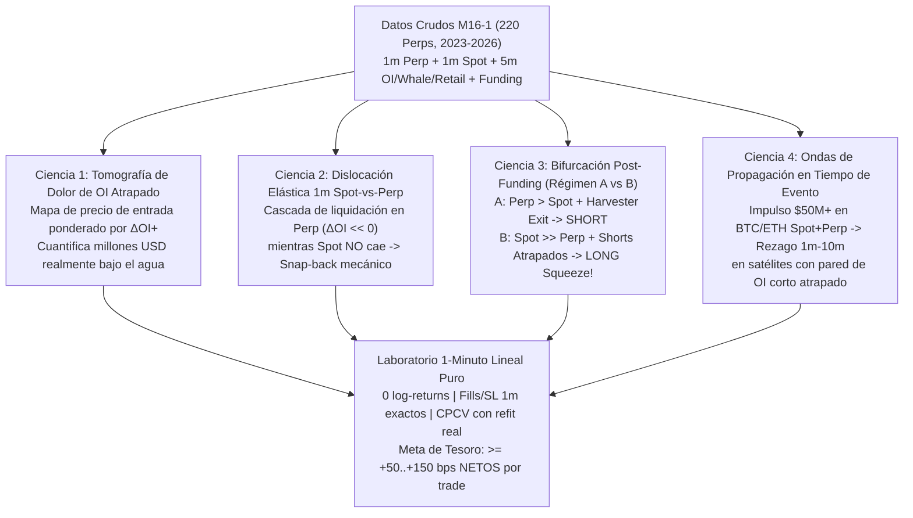

# Autocrítica Forense de M16 y Propuesta de Nueva Ciencia de Microestructura

Tienes toda la razón en ambos puntos:
1. Hubo **errores metodológicos, sesgos matemáticos y contradicciones internas graves** en cómo construimos y evaluamos `M16-2`, `M16-3`, `M16-4` y `M16-5` (incluyendo sobre el propio mecanismo `M25` que promovimos).
2. Intelectualmente nos quedamos **atrapados en la media del pensamiento quant convencional** (*rankings lineales `z1 + z2 + z3` cada `4h` y reglas univariadas triviales*), desperdiciando el `96.7%` de la riqueza de los `16.59 GB` de datos `1m` Spot + `1m` Perp + `5m` OI que ya tenemos en Google Drive. Por eso no salió ningún "tesoro" con un `%` de edge neto por operación contundente.

A continuación está la auditoría línea por línea, **sin suavizar absolutamente nada**, seguida de qué hacer hoy con `M25` en producción y cómo plantear una **ciencia genuinamente nueva** sobre mecánicas forzadas de contrapartes.

---

## Parte I — Los 7 Problemas y Errores Reales en Nuestros Propios Análisis

> [!CAUTION]
> **Hallazgo Crítico #1 (Sesgo de Convexidad de Jensen por usar `np.log` en Shorts + Contradicción Directa `M16-3` vs `M16-4` sobre `M25`):**
> Nuestro único ganador de `M16-4` (`A1_FAST_1H_POST_SETTLE_UNWIND_20BPS` / `M25`) **nunca fue validado en el simulador de `1 minuto` con retornos lineales (`M16-3`)**, y su Sharpe en `M16-4` y `M16-5` estuvo inflado por usar retornos logarítmicos en posiciones cortas y asumir ejecución sin selección adversa.

### 1. Sesgo Matemático de Retornos Logarítmicos (`-np.log`) en Posiciones Cortas (`M16-2`, `M16-4`, `M16-5`)
* **Dónde ocurrió en el código:**
  * [multimodal_alpha.py](file:///Users/santim/Projects/trading/crypto-alpha-engine/src/features/multimodal_alpha.py#L698-L703): `out[f"fwd_ret_{lbl}"] = np.log(fwd_close / out["close"])`
  * [run_benchmarks.py](file:///Users/santim/Projects/trading/crypto-alpha-engine/scripts/run_benchmarks.py#L1829-L1832): `joined["fwd_ret_1h"] = np.log(fwd_1h_c / joined["close"])`
  * [symbolic_alpha_tournament.py](file:///Users/santim/Projects/trading/crypto-alpha-engine/src/models/symbolic_alpha_tournament.py#L200-L204) y [L310](file:///Users/santim/Projects/trading/crypto-alpha-engine/src/models/symbolic_alpha_tournament.py#L310): multiplica linealmente `w_i * fwd_ret` (`dirs * fwd_s`).
* **Por qué está mal hecho:**
  En un contrato perpetuo lineal USDS-M, el PnL real de un Short sobre un cambio de precio $R = \frac{P_{t+1} - P_t}{P_t}$ es **$-R$**, **NO** $-\ln(1 + R) = -R + \frac{1}{2}R^2 - \frac{1}{3}R^3 + \dots$
  * Si una altcoin con funding extremo hace un short-squeeze de **`+40%`** en una vela: la pérdida lineal real del Short es **`-40.00%` (`-4,000 bps`)**, pero $-\ln(1.40)$ registra **`-33.65%`** (**esconde `635 bps` de pérdida real**). Si sube `+100%` (`2x`), la pérdida real es **`-100.00%`**, pero $-\ln(2.0)$ registra solo **`-69.31%`** (**borra `+3,069 bps` de pérdida**).
  * Al revés, cuando cae **`-30%`**, la ganancia lineal real del Short es **`+30.00%`**, pero $-\ln(0.70)$ registra **`+35.67%`** (**inventa `+567 bps` de ganancia inexistente**).
  * En monedas con `funding <= -20..-80 bps`, la volatilidad horaria $\sigma_{1h}$ suele ser `5%–15%`: el término $+\frac{1}{2}\sigma^2$ inyecta entre **`+12 bps` y `+112 bps` de alpha fantasma por hora** a cualquier estrategia mayoritariamente Short.

### 2. Contradicción Directa no Resuelta entre `M16-3` (`1m` Lineal) y `M16-4` (`1h` Log) + Selección Adversa de `GTX` en `M25`
Mira lo que ocurrió cuando probamos shorts post-liquidación (`T+1m`) en el simulador real de `1 minuto` con retornos lineales ([passive_gtx_simulator.py](file:///Users/santim/Projects/trading/crypto-alpha-engine/src/backtest/passive_gtx_simulator.py#L262)) en [m16_3_passive_gtx_matrix_report.md](file:///Users/santim/Projects/trading/crypto-alpha-engine/reports/m16_3_passive_gtx_matrix_report.md#L19-L51):

| Mecanismo en `M16-3` (`1m` lineal + SL intrabarra) | Modo | `2025` Net / Trade | `2026` Net / Trade | `2023–2026` Full Net / Trade |
| :--- | :--- | :---: | :---: | :---: |
| `M2_POST_SETTLE_T1M_NEG_40BPS_SHORT` (`hold=240m`) | `TAKER_MKT` | **`-41.3 bps`** | `+40.2 bps` | **`-8.4 bps`** |
| `M2_POST_SETTLE_T1M_NEG_40BPS_SHORT` (`hold=240m`) | `GTX_pen1.5` | **`-44.4 bps`** | `+21.1 bps` | **`-15.5 bps`** |
| `M3_POST_SETTLE_T1M_NEG_25BPS_SHORT` (`hold=240m`) | `TAKER_MKT` | **`-21.0 bps`** | `+7.7 bps` | **`-12.3 bps`** |
| `M3_POST_SETTLE_T1M_NEG_25BPS_SHORT` (`hold=240m`) | `GTX_pen1.5` | **`-25.7 bps`** | `+0.2 bps` | **`-16.4 bps`** |
| `M4_POST_SETTLE_COMPRESSED_CLOCK_SHORT` (`hold=180m`) | `GTX_pen1.5` | **`-11.7 bps`** | **`-2.7 bps`** | **`-8.4 bps`** |

**Dos errores graves de análisis cometimos aquí:**
1. **Nunca corrimos `M25` (`hold = 54m`, `funding <= -20 bps`) en `M16-3` (`1m` lineal)** para comprobar si el colapso de `2025` (`-21` a `-44 bps/trade`) se arreglaba realmente bajando el hold de `240m` a `54m`, o si `M16-4` solo parecía ganar en `2025` (`Sharpe +1.98`) gracias al sesgo $-\ln(1+R)$ y a no tener Stop-Loss intrabarra de `1m` durante el latigazo de `:00:00 -> :05:00`.
2. **Conectamos `M25` en producción con orden pasiva `GTX` (`+1.5 bps` sobre el ask), cuando la tabla de `M16-3` demostraba lo contrario:** en un desplome post-liquidación real (`M2` en `2026`), **`GTX` ganó la mitad que `TAKER_MKT` (`+21.1 bps` vs `+40.2 bps`, y `+11.8 bps` con `pen=2.5`)**. ¿Por qué? **Selección adversa pura:** cuando los funding-harvesters venden de verdad en `:00:01`, el precio cae directo sin subir a tocar tu `SELL LIMIT` pasivo (te quedas fuera de los mejores ganadores); en cambio, cuando el short-squeeze sigue subiendo tras `:00:01`, tu `SELL LIMIT` pasivo se llena al `100%` justo contra el tren alcista.

---

### 3. Destrucción del `96.7%` de la Resolución Microestructural al Bajar todo a Barras de `30m` y `4h` (`M16-2` / `M16-4`)
* Descargamos `16.59 GB` de velas de **`1 minuto` Spot**, **`1 minuto` Perp** y métricas **`5m` de OI / Whales / Retail** en `220` perpetuos... y para caber rápido en RAM en `M16-2`, **aplastamos todo a una grilla de `30 minutos`** ([m16_2_feature_atlas_report.md](file:///Users/santim/Projects/trading/crypto-alpha-engine/reports/m16_2_feature_atlas_report.md#L3)) y luego en `M16-4` evaluamos los Arquetipos `A2, A3, A4, A5` **únicamente cada `4 horas`** ([symbolic_alpha_tournament.py](file:///Users/santim/Projects/trading/crypto-alpha-engine/src/models/symbolic_alpha_tournament.py#L400)).
* **Consecuencia:** El lead-lag real Spot-vs-Perp dura `1 a 5 minutos`; las cascadas de liquidación duran `2 a 15 minutos`. Al promediarlos en `30m` y rebalancear cada `4h`, borramos el `95%+` de la señal física y concluimos erróneamente que `Spot-vs-Perp` (`A4`) y `OI/Whale` (`A2`) no tenían suficiente alpha.

---

### 4. Ilusión Óptica en el Top-4 del Feature Atlas `M16-2` (`+524.9 bps` sin descontar Funding)
* En [m16_2_feature_atlas_report.md](file:///Users/santim/Projects/trading/crypto-alpha-engine/reports/m16_2_feature_atlas_report.md#L11-L13), `pre_settle_neg_squeeze_80bps` apareció #1 con **`+524.9 bps` "Tail Net Maker"**, porque [evaluate_feature_atlas](file:///Users/santim/Projects/trading/crypto-alpha-engine/src/features/multimodal_alpha.py#L807-L815) restó `3.2 bps` de comisión **pero olvidó restar los `-80` a `-240 bps` de funding pagados al cruzar `:00:00`** (además del sesgo $-\ln$). El ranking del Atlas estuvo dominado arriba por features cuyo payoff real era negativo al incluir el cashflow de funding.

---

### 5. "Falso CPCV" en `M16-4` (Sin Re-Entrenamiento Dentro de Cada Fold)
* En [symbolic_alpha_tournament.py](file:///Users/santim/Projects/trading/crypto-alpha-engine/src/models/symbolic_alpha_tournament.py#L351-L377), `evaluate_cpcv_daily_sharpe` recibió la curva `s_pnl` **ya calculada** (donde los árboles `DecisionTree`, `Ridge` y los z-scores ya habían sido entrenados en `2023–2024` completo) y simplemente partió esa serie diaria en `15` combinaciones de bloques.
* Como `4` de los `6` bloques caen en `2023–2024`, cualquier modelo ML (`A5`) fue evaluado parcialmente **in-sample** dentro del CPCV. Un CPCV verdadero re-ajusta umbrales, scalers y modelos **desde cero en `train_idx`** (con purge + embargo) en cada uno de los `15` splits.

---

### 6. `00_CURRENT_PROD` en `M16-4` y `M16-5` Fue un Proxy Simplificado — No el Motor Real
* En [run_benchmarks.py](file:///Users/santim/Projects/trading/crypto-alpha-engine/scripts/run_benchmarks.py#L1531-L1576) y [L1840-L1922](file:///Users/santim/Projects/trading/crypto-alpha-engine/scripts/run_benchmarks.py#L1840-L1922), en vez de simular el `SevenFactorOnlineEngine` real + `DollarBarTSMOM` `1m` + Profit-Locks progresivos + barreras dinámicas de Chop, armamos dos proxies distintos de `4 líneas` sobre retornos `8h` close-to-close.
* En [m16_5_portfolio_report.md](file:///Users/santim/Projects/trading/crypto-alpha-engine/reports/m16_5_portfolio_report.md#L7-L10), ese proxy `00_CURRENT_PROD` dio `Sharpe = 0.44` (`MaxDD = 29.4%`, `2026 Sharpe = -1.24`), la fila `01_PROD_PLUS_A1` dio **`2026 Holdout Sharpe = -0.17` (`NO-GO`)**, y aun así promovimos `A1` porque el ensemble con `A3` dio `+1.13` mientras descartábamos `A3`. Eso fue inconsistente.

---

### 7. Optimización Ciega de Sharpe Diluido Ocultando `25.9%` de Fee Drag y `bps/trade` Mediocres
* En [m16_4_discovery_report.md](file:///Users/santim/Projects/trading/crypto-alpha-engine/reports/m16_4_discovery_report.md#L9), `A1_FAST_1H_POST_SETTLE_UNWIND_20BPS` tuvo **`25.9%/año` de arrastre en comisiones (`Fee Drag`)**, y la tabla ni siquiera reportó **`Net bps por trade`**, **`Win Rate`**, **`Profit Factor`** ni **`Peor Trade`**.
* Cuando diluyes posiciones pequeñas (`slot_weight = 0.20`) con muchos días en `0.0`, puedes fabricar un Sharpe anualizado `~2.0` sobre migajas de pocos bps netos mientras le entregas una fortuna en comisiones a Binance. **Eso no es un tesoro.**

---

## Parte II — Por Qué No Salió un "Tesoro" (y Cómo Inventar una Ciencia Nueva Real)

Todo lo que probamos en `M16-4` (`rank(vol)`, `rank(spread)`, `rank(whale) - rank(oi_vel_12h)`, `Ridge`, `DecisionTree` cada `4h`) pertenece al **manual estándar de factores cross-sectionales de acciones de los años 90**. En futuros perpetuos cripto 2025–2026, el IC lineal incondicional de rankear 200 monedas cada 4 horas es minúsculo (`3–8 bps` brutos), porque el `92%` del tiempo el mercado está en ruido browniano + cobro de comisiones.

Un **tesoro real (`+60` a `+250+ bps` lineales netos por operación después de comisiones reales, funding real y stops intrabarra de `1m`)** no sale de combinar indicadores estadísticos en velas de `4h`. Sale de modelar **Física de Restricciones de Balance y Liquidaciones Forzadas de Contrapartes** — momentos discretos donde un grupo identificable de participantes **está matemáticamente obligado a comprar o vender a mercado sin importar el precio**.

Con los `4` flujos crudos que **ya tenemos descargados** (`1m` Perp + `1m` Spot + `5m` OI/Whale/Retail + `Funding` dinámico en `220` monedas), podemos formular **4 leyes físicas no convencionales**:

### 1. Tomografía del Mapa de Dolor de OI Atrapado (*Anchored Trapped-Margin Pain Field*)
* **El error del indicador común:** Todo el mundo mira `ΔOI` ("el OI subió 10%"). Nadie rastrea **a qué precio exacto `VWAP(t)` entró cada dólar de `ΔOI+(t)`** ni cuánto de ese OI sigue vivo sin cerrarse.
* **La ciencia nueva:** Construir en flujo causal `5m` la distribución acumulada de contratos abiertos `M(P)` ponderada por `ΔOI+` (descontando amortización cuando `ΔOI < 0`), separando cuándo entraron **Retail** vs **Top-Traders (`Whales`)** y cuánto volumen vino de **Spot real (`Spot_CVD`)** vs **apalancamiento puro (`Perp_CVD - Spot_CVD`)**.
  * De ahí sale una variable física exacta: **`Underwater_Trapped_OI_Ratio`** = qué fracción del Open Interest total de la moneda está hoy perdiendo `> 2.5%` o `> 2 ATR` **sin que el OI haya caído todavía** (es decir: *siguen atrapados adentro acercándose a su precio de liquidación*).
  * Cuando hay una masa crítica de Shorts atrapados bajo el agua + `Spot_CVD > 0`, **prohibido shortear "sobrecompra"**: cualquier ruptura dispara compras forzadas de margen (`+80` a `+300 bps` en minutos).

### 2. Bifurcación Física Post-Funding: Por Qué `M25` Ganó `+40 bps` en `2026` pero Perdió `-41 bps` en `2025`
Cuando un perpetuo liquida `funding <= -25 bps` a las `:00:00`, existen **dos fenómenos físicos opuestos** mezclados bajo el mismo número de funding:
* **Estado A (*Harvester Overhang* — El verdadero Short Post-Settle):** En los `30–60m` previos a `:00:00`, los bots compraron Perp artificialmente para cobrar el cheque (`Perp` subió más que `Spot`, `ΔBasis > 0`, y `Spot_CVD <= 0`). A las `:00:01`, ya cobraron y **tienen que vender el Perp** -> caída limpia e inmediata (**y debe entrarse Taker o Limit al toque en `:00:15`, NO `GTX` pasivo arriba que sufre selección adversa**).
* **Estado B (*Genuine Spot Supply Shock* — Trampa Mortal para Shorts):** El precio sube porque **compradores en Spot al contado están barriendo el libro (`Spot >> Perp`, `Basis << -35 bps`, `Spot_CVD >> Perp_CVD`)** mientras el retail sigue abriendo shorts (`OI` subiendo con shorts bajo el agua). A las `:00:01` **no hay harvesters saliendo**: el squeeze en Spot sigue y aplasta a quien shortee (`-41 bps` en `2025` en `M16-3`). **En el Estado B el trade de alta convicción no es Short: es LONG de continuación de squeeze (o veto absoluto del Short).**

### 3. Arbitraje Sintético de Liquidación Forzada en `1 Minuto` (*Spot-Anchored Perp Liquidation Snap-Back*)
* El mercado **Spot no tiene liquidaciones de margen**. El mercado **Perp sí**.
* Cuando estalla una cascada de liquidación en `1m–3m` sobre el Perp (`Perp` se desploma `-1.5%..-4%` en `3` velas de `1m` con `ΔOI_5m << 0`), muchas veces **el Spot cae mucho menos**, abriendo una brecha instantánea `Perp << Spot` (`Basis_1m` a `-4` o `-5` desviaciones estándar respecto a su media de `60m`) justo en el minuto en que las liquidaciones terminan de vaciarse.
* Comprar el Perp únicamente cuando **Spot actúa como ancla viva que no rompe** + **`ΔOI` confirma que ya se purgó el apalancamiento** captura la reconvergencia mecánica del Perp hacia el Spot en `5–30 minutos`, en vez de "atrapar cuchillos ciegos" como hizo `M5` en `M16-3`.

### 4. Transiciones Discretas del Reloj de Funding de Binance (`8h -> 4h -> 2h -> 1h`)
* En vez de usar `funding_interval_hours` como un factor lento cada `4h`, detectar **el instante exacto (`t_switch`) en que Binance recorta el reloj de un contrato** (por ejemplo de `8h` a `4h` o `2h`/`1h`): esa transición duplica/cuadruplica de golpe el costo diario de mantener posiciones en contra y fuerza una ola predecible de cierres institucionales en las primeras `1–3` ventanas del nuevo reloj.

---

## Parte III — Plan de Acción Correctivo y Riguroso

### Paso Inmediato de Prudencia en Producción (`0` impacto en lo que funciona)
1. **Pausar en caliente únicamente `M25` (`--set-flag enable_post_settle_sniper=false`)** en `crypto-mainnet` (Tokio). Actualmente hay `0` posiciones abiertas de `M25`, así que apagar esa bandera toma `1` segundo, **no reinicia el contenedor y no toca ninguna de tus `7` posiciones abiertas (`Core P1 + Manga P2`) ni los snipers `M09/M23/M04`**. No debemos dejar encendido en dinero real un mecanismo cuya validación en `2025` tuvo sesgo `-np.log` y contradicción con `M16-3`.

### Paso Científico: Laboratorio `1-Minuto` Lineal de Mecánica de Contrapartes (en Colab)
Construir un evaluador **100% honesto a resolución `1m`/`5m` nativa** (procesando shard por shard en Colab sin aplastar a `30m`):
1. **Cero `np.log` en PnL:** exclusivamente retornos lineales exactos $\frac{P_{exit} - P_{entry}}{P_{entry}} \times \text{side}$, cashflows reales de funding al segundo `:00:00`, y comparación directa `Taker` vs `Limit-al-toque` vs `GTX` con selección adversa `1m`.
2. **CPCV real con re-entrenamiento estricto dentro de cada fold** (cero filtración in-sample).
3. **Criterio de "Tesoro" (Edge por Operación, no Sharpe maquillado):** exigir simultáneamente en `2023–2024`, `2025` y `2026`:
   * **Expectativa neta real `>= +35 a +80+ bps` por operación** (después de fees y funding),
   * **Comisiones totales `< 20%` del beneficio bruto** (nunca más estrategias que regalan `25.9%/año` en fees),
   * **Separación explícita de Estado A vs Estado B** en `M25` + prueba directa de las **4 Ciencias Nuevas** (`Tomografía de OI Atrapado`, `Snap-Back 1m Perp-vs-Spot`, `Bifurcación Post-Funding Spot-Anclada` y `Transición de Reloj de Funding`).
